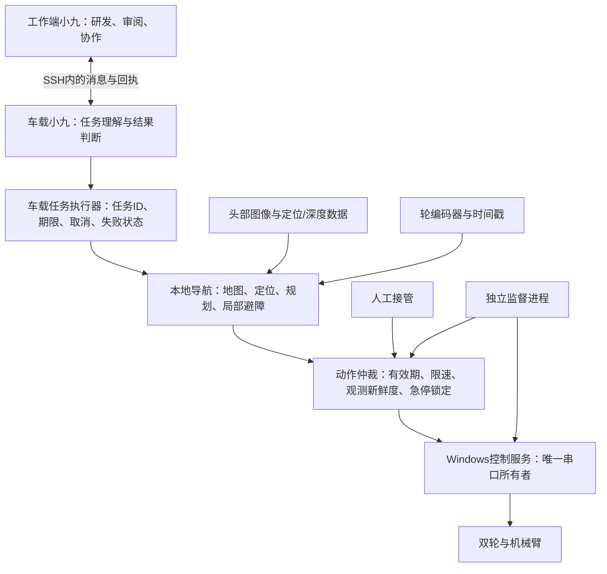

# 车载独立智能与导航实施方案

日期：2026-11-02。硬件安装、供电和正常Wi-Fi可用性按用户要求视为已解决；本方案集中处理软件、导航和异常停止。传感器实际能提供的数据仍按证据区分，不能因硬件准备完成就假定普通RGB相机能输出度量深度。

## 结论与当前能力

真正的室内寻路需要三个闭环：**地图/站点描述空间，定位确定机器人在哪里，局部感知与控制决定此刻能否安全移动**。有地图仍需实时避障；视觉理解不能替代实时控制和停车。

本仓库的核验结果：

| 能力 | 当前情况与证据 |
|---|---|
| Windows车载控制 | 已部署；双板、16电机、三路机器人相机及手柄已有实机记录 |
| 轮速转换/停车 | `original_runtime.py`已有`wheel_command`、`_drive_base`、`_zero_wheels`；几何默认来自资料，连续运动里程计还未验收 |
| 手臂自主步骤 | `agent_ops.py`已支持move/probe/snapshot/sample等，首轮实机报告已归档；当前拒绝底盘轮 |
| LLM视觉移动示例 | `docs/en/source/software/getting_started/LLM_agent.md`使用RoboCrew和独立ServoControler，属于参考路径，不能并行启动后抢占现有串口 |
| 全屋导航 | 未发现接好的SLAM、地图服务、定位、代价地图、路径规划或Nav2运行配置；`platform_catalog.py`也明确标为待集成 |
| 传感器 | 已验证头部RGB、右腕RGB、左腕RGB和笔记本摄像头；未取得这些相机提供度量深度、同步双目或激光扫描的证据 |
| 车载智能环境 | 本轮准备完整源码工作区、既有小九引擎后台会话、持久消息桥和源码自动快进同步；具体验收见台账 |

## 系统分工

工作端离线不应终止笔记本服务。运动执行由车载任务与控制进程负责；云端模型超时或任务结果不确定时取消任务并停车。模型只提交目标站点和任务，不连续生成轮速，不负责高频避障。底盘与抓取初期分阶段执行，移动时保持已验收的收臂姿态。

## 选定的导航路线

采用统一任务/控制接口，分两个验收阶段实施，而不是另开一套直接写串口的机器人程序。

**第一阶段：现有RGB的标记/固定区域导航。** 用已知尺寸的AprilTag站点提供度量定位，轮里程计补充短时运动，建立带坐标、可通行边和禁行区的拓扑地图；头部图像提供局部可通行区/障碍判断。先跑有限房间内的已勘察路线，障碍出现就停止或在已有安全路径内重规划。未知地面、定位丢失和看不清的区域都不自动进入。这一阶段可以复用现有RGB，但不能宣称已具备任意环境的稠密深度避障。

**第二阶段：标准地图导航主线。** 保留Windows USB/串口控制，车载WSL2 Ubuntu 24.04中运行ROS 2 Jazzy与Nav2；采用RGB-D + RTAB-Map生成/重定位二维占据地图，或者在已有`LaserScan`输入时使用slam_toolbox建图与AMCL定位。选择由实际可用输入确定，任务与执行接口保持一致。RGB-D是视觉主线；普通单目不能直接当作RGB-D接入。若实际只有RGB，则继续第一阶段的能力边界，先验证单目+里程计的尺度和定位稳定性，再考虑视觉SLAM扩展。

不把三只分散在活动头部与手腕的相机当成已经标定同步的三目系统；不把大模型估计的距离或单目深度网络输出直接当作停车距离的唯一依据。

## 实施顺序与交付物

| 阶段 | 实现与交付 | 动作开放门槛 |
|---|---|---|
| A 独立环境 | 完整源码、会话桥、源码快进同步、后台启动、消息回执 | 本轮先观察/规划，不开放底盘 |
| B 动作安全基础 | 唯一执行租约、带有效期轮速接口、锁定式停止、独立监督进程、故障注入记录 | 所有过期/断连/崩溃停车测试通过 |
| C 几何与里程计 | 轮方向、轮径/轮距、编码器连续性、时间戳、`odom→base_link`、真实足迹 | 直线/转向误差和停车延迟达到约定门槛 |
| D 感知与第一张地图 | 相机内外参、导航头部姿态、Tag坐标、路线图/禁行区、局部障碍掩码 | 定位与图像过期立即阻断，障碍/未知区域测试通过 |
| E 首个到点任务 | A点到B点、途中停车、取消、重定位、失败回执 | 反复到点和全部异常用例通过 |
| F 全局导航 | WSL2/ROS2桥、度量感知、SLAM/Nav2、保存地图与重定位 | 无人进入场地时先验收，随后验证动态障碍 |
| G 移动操作 | 到点停车确认后再抓放，失败停留并报告 | 导航与抓放各自稳定，禁止初期边走边伸臂 |

每阶段保留源码提交、配置版本、输入数据、遥测、动作回读和结果。模拟通过、源码已同步与实机可安全运行分别记录。

## 底盘桥与里程计

新增接口应由现有Windows控制服务实现，继续共用同一`io`锁和真实USB身份解析：

| 接口/数据 | 契约 |
|---|---|
| 申请执行租约 | owner、mission_id、lease_id、到期时间；与手柄/自检/采集/手臂步骤互斥 |
| 速度命令 | lease_id、单调递增seq、v_m_s、omega_rad_s、valid_for_ms；过期、乱序、失效租约拒绝 |
| 停止 | 幂等、优先级最高，清空排队速度，双轮零速并回读；无法确认时标为stop_unconfirmed |
| 里程计 | 左右轮位置/速度、设备身份、源时间戳、接收时间、有效位与协方差 |
| 本机任务状态 | pending/running/succeeded/cancelled/failed/interrupted，完成必须有到点与零速证据 |

沿用`wheel_command()`完成米/秒、弧度/秒到舵机速度的转换，并沿用已保存轮映射和方向。禁止在ROS中再猜一次左右轮正负。

轮模式下先实测位置寄存器是否持续变化、如何回绕、掉电是否重置。仅在验证后才解包回绕并积分`Δs=(ΔsL+ΔsR)/2`、`Δyaw=(ΔsR-ΔsL)/轮距`。若只有速度积分，明确提高不确定度并依赖外部定位修正；不能标为编码器里程计已验收。资料默认轮径127mm/轮距250mm不是本轮实测尺寸。

建议验收目标：直线1m误差不超过5cm、原地一圈角度误差不超过5°，并测量重复性与地面打滑；这些是初始门槛，不是已有结果。坐标统一为x向前、y向左、z向上。

## 地图与定位

第一阶段先固定导航时的头部姿态并完成相机标定；如允许转头，应使用与图像同步的关节读数更新外参。腕部相机用于抓取，笔记本镜头作为补充观察，不默认替代前方低处的导航视野。

Tag站点以已知尺寸和相机内参解PnP，得到`map→base_link`；要求重投影误差、距离与姿态一致性合格，过滤单帧跳变。移动间隔由轮里程计传播，定位置信度不足即停。先建立房间站点、通道、禁行区与可回退点，再做路线学习；自动探索不作为首轮任务。

第二阶段二维占据地图建议从5cm网格开始，保存地图、原点、分辨率、传感器标定和版本。全局规划只走已知可通行区域，未知默认不可通行；局部代价图持续更新临时障碍。真实足迹必须包括收起的手臂、笔记本和外伸件，不能仅用轮距作为车体宽度。

ROS链路：`map→odom→base_link→camera_link`保持连续，`/odom`来自Windows编码器，`/tf`与`/camera/*`带源时间戳；深度或`/scan`按实际输入接入。Nav2输出的`cmd_vel`必须经过动作仲裁与本地超时器，不能直接穿透为串口写入。

## 视觉避障

现有`app.py`的MJPEG接口配置为640×480/15fps，但每个连接各启一个ffmpeg采集进程，尚无统一帧缓存；已归档的助手冷启动抓图约需2.6–3.5秒。导航必须改为每台相机一个常驻采集器，带源时间戳向网页、模型与避障共享最新帧，避免多个客户端抢占同一UVC设备。不能把低频助手抓图循环当作满足300ms新鲜度的避障输入；15fps配置也需要实测端到端帧龄。

第一阶段使用相机标定与地面投影评估已观测的可通行区域，结合障碍/人检测。低置信度、不明地面和视野盲区标unknown并停车；识别到“地板”也不等于该区域没有细线、小物或落差。具备度量深度后，将点云中位于可碰撞高度的点投影为局部占据格，并保留地面缺失/落差的阻断信息。

局部规划按“减速→停车→确认→重规划”处理新障碍。仅当可用地图、定位和当前感知共同证明绕行路径可通行时绕过；否则保持停止并报告。初期关闭会在未知空间后退/原地大幅旋转的自动恢复动作。

首轮速度上限建议0.10m/s、角速度0.35rad/s；实际开放值由停车距离和感知延迟测试决定。障碍阈值至少覆盖车体足迹、定位误差、感知/控制总延迟和制动距离，不能用固定小距离套用所有速度。

## 异常处理与停止契约

以下是运动接入前必须实现并实测的契约，不把本轮的只读消息桥测试写成电机停车验收。

| 异常 | 车载处理 | 恢复 |
|---|---|---|
| 速度命令过期/乱序 | 当地看门狗写双轮零速，撤销执行租约 | 新租约与新任务，旧速度不重放 |
| 模型请求超时/流中断 | 任务取消，导航取消，停车；手臂按预先确定的保持策略停止 | 查状态后重新规划 |
| 导航进程退出/卡住 | 心跳超期停车并锁定任务 | 重定位、显式解除故障 |
| 图像/深度/里程计过期 | 立即减速停车，不沿用陈旧“无障碍”判断 | 连续新鲜且一致的数据后重新准入 |
| 定位丢失/跳变 | 停车、阻断路径执行 | 原地重定位；不自动盲走寻找标记 |
| 断网 | 若影响当前模型/任务有效性则取消并停车；本地安全线程继续运行 | 连通不自动续跑旧动作 |
| 工作端关闭 | 笔记本服务继续运行；观察/通信任务可独立完成 | 以任务ID重新读取回执；不假装工作端仍在线 |
| 控制服务崩溃 | 独立监督进程确认旧串口所有者退出后接管停车；重启为无运动状态 | 先验证零速与状态，再准入 |
| 串口错误/USB重连 | 撤销租约、标记停车是否确认；重连只监控 | 设备身份和零速复核后新准入 |
| 人工接管/急停 | 最高优先级取消自主任务 | 急停锁定，人工解除并重定位 |
| 重启/任务结果未知 | 记interrupted，清空有效运动队列 | 查询、检查、重新提交新任务 |

建议初始时限：速度有效期250ms、控制看门狗检查20ms、导航心跳200ms、前方感知最大年龄300ms、定位最大年龄500ms。时间使用本机单调时钟计算；远端时间只作记录，不能依赖两机时钟完全一致。这些是待验证目标，现有串口扫描若不能满足，应先改为优先停车/轮速写入和较低频全机遥测，再开放移动。

监督进程必须独立于模型和导航；控制服务退出后才允许其成为临时串口所有者，避免串口争抢。操作系统整体冻结或笔记本断电不可能仅靠同一台电脑的软件保证停车，需要对接已准备好的独立设备失联保护；这是软件安全接口边界，不新增硬件采购任务。

## 车载资源与部署

按车载i5-8265U/约8GB/MX250规划，避免将工作端RTX4060配置套用过来。Windows继续运行控制服务、消息桥和必要图像采集，模型沿用云端；WSL2在第二阶段再安装与验收，初始限制约3GB内存并实测CPU/内存余量。图像从低分辨率和低帧率起步，关闭非必要可视化和全部相机长期高分辨率推流；最终帧率由速度与观测新鲜度门槛决定。

Windows与WSL之间采用本机消息桥，传送时间戳图像/里程计和受限速度请求；不将USB串口直接转移给WSL，也不另起ROS串口驱动。Nav2、RTAB-Map及其依赖固定为同一ROS发行版，升级先离线回放和故障注入，再发布。

## 首个真实到点任务与验收

任务：在已勘察房间中，从A站点低速到B站点，遇障停住，达到允许误差后停车并回报。先不同时抓取。

1. 原地预检：设备身份、零速、收臂姿态、地图版本、定位和最新前方观测。
2. 规划：验证整段路径与车体足迹，未知区域拒绝。
3. 执行：车载导航持续更新受限速度，每条命令带期限。
4. 到达：建议初始误差≤15cm/10°，双轮零速且位置稳定后才标succeeded。
5. 人工插入障碍、遮挡镜头、断模型网络、终止导航进程、终止会话桥、重启控制进程；分别保存从故障到零速的时间和轮速回读。
6. 连续多轮A↔B到点后，再加入已勘察绕行路径、第二房间和“到点后抓放”。

每个异常用例必须核对真实输出，不能仅看HTTP成功或页面显示“已停止”。控制服务硬崩溃时零速是否可确认必须单独记录。

## 参考与核验边界

- [Nav2官方文档](https://docs.nav2.org/rolling/)：已读取，用于地图/定位/规划/控制架构参考；实施时锁定Jazzy兼容版本。
- [RTAB-Map ROS候选集成](https://github.com/introlab/rtabmap_ros)：候选依赖，不代表本项目已安装或验证。
- [ROS 2 Jazzy Ubuntu安装文档](https://docs.ros.org/en/jazzy/Installation/Ubuntu-Install-Debs.html)：实施入口，不代表本轮已安装WSL/ROS。
- 仓库现有源码与[首轮受限运行报告](../../fabrication/assembly/debug_console/AGENT_ROUND1_REPORT_ZH.md)是当前能力证据。
- 小九随附引擎为本机核验的0.163.0；调用参数通过实际CLI帮助与车载通信验证。官方app-server页面本轮取回了部分协议正文，后续完整抓取受重定向/403影响；没有据此假定未验证的桌面UI或跨设备会话API。
