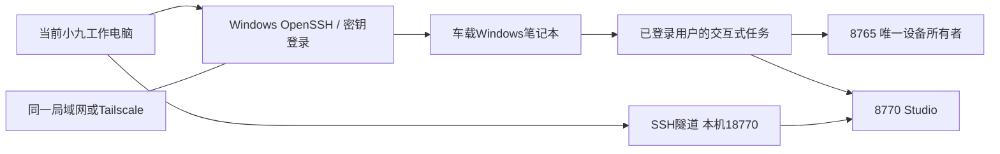

# 车载 Windows 中控迁移与远程操作

2026-10-29用户新决定：换一台Windows笔记本，直接放在机器人上做中控，后续由当前工作端通过远程连接部署和操作。此前“车上不放笔记本、手机做终端”的偏好作为历史方案保留，当前按新决定准备。新机型号、CPU/GPU、内存和系统版本尚未确定。

> 同日真实部署更新：华为WRT-WX9（i5-8265U、约8GB、MX250、Windows11专业版x64）已部署到`D:\Robot\XLeRobot`，新机76项离线测试、交互式预览及工作端18770隧道访问通过。实际安装发现并修复了PowerShell5.1的Python参数引号和中文脚本编码问题（`f563ae2`、`a0f5168`）；此前已生成的旧包不含这些修复，继续安装应从当前仓库重建包，或按前后哈希清单同步修复文件。SSH升级后的1072服务待删除/自启问题仍单独待处理，尚不能宣称重启后远程恢复已通过。详见仓库`PROJECT_STATE.md`最新条目。

## 已准备的交付物

离线迁移包按 **Windows x64 + Python 3.11** 构建。新机若为ARM64，请先提供架构，不直接使用此运行环境。

- `project.zip`：当前维护仓库的受审源码、Studio、手册、CAD/仿真脚本和配图；不含Git历史、仓库示例私钥、虚拟环境、日志或实时会话。
- `runtime-reference.zip`：当前设备寄存器快照、存在时的运动学参考标定，以及Studio轨迹/姿态/实验配置。仅本地迁移，不上传Git，不自动恢复到生效路径。
- `installers/`：Python 3.11.9 x64官方安装器、微软VC++ x64运行库安装器；准备阶段没有执行安装器。
- `wheelhouse/`与`requirements-core.lock`：已经下载并锁定版本的控制台依赖；不包含PyTorch/CUDA、训练模型或仿真虚拟环境。源码和现有研究图片照常保留。
- `tools/ffmpeg.exe`：当前电脑已有FFmpeg的展示/视频运行依赖，启动脚本仅为子进程增加本地工具路径。
- `remote/controller.pub`：专用SSH公钥；对应私钥保留在当前工作电脑的`%LOCALAPPDATA%\XLeRobotRemote\controller_ed25519`，不进入迁移包。
- `manifest.json`和外部`.zip.sha256`：逐文件SHA-256、源码提交号与包校验值。
- `validation/`、`validation-result.json`和测试XML：便携Python及可选测试轮子、本机离线兼容验收记录；默认安装不加载测试工具。当前74项Python测试、3套Node检查及本地模拟SSH客户端验证通过，不等于新机联调完成。

离线依赖以该包的锁文件为准。Python 3.11.9是此兼容包选择的官方Windows安装器版本，不代表Python最新版本。后续升级要重新解析并验证轮子；不要复制旧电脑的`.venv-*`目录。

## 你先准备什么

1. 新机型号、CPU、内存、GPU；Windows版本和x64/ARM64架构，可提供“设置→系统→系统信息”中的文字。只做控制和视频不要求独显，训练/视觉模型另评估。
2. 说明新机和当前工作电脑是否在同一Wi-Fi/局域网。跨网络建议两端安装Tailscale并加入同一可达网络；**Windows仍运行OpenSSH Server，不使用Tailscale SSH代替Windows服务**。
3. 新机本地Windows账号名称、电脑名，以及可用的局域网/Tailscale IP。账号需在新机本地登录过一次，首次启用SSH需要新机上的管理员PowerShell。准备脚本支持ASCII本地账号名；域账号、中文账号或微软账号先核对登录名后适配。
4. 机器人USB控制板、相机、手柄将接在哪台电脑；手柄要配对到车载新机，旧电脑的XInput输入不会自动通过SSH转发。
5. 新机保持供电、用户已登录、允许桌面应用访问摄像头、操作期间不进入睡眠。合盖策略、蓝牙配对、USB驱动和摄像头权限在新机上逐项确认。
6. 首次实机测试时你在设备旁，能人工支撑机械臂并处理供电/停止；先完成只读和预览验收，再进行实机动作。

可运行包中`remote/collect-info.ps1`生成`preflight.json`，其中包含系统、账号、IP、设备名称及存在时的Python/XInput枚举；它不会打开串口或相机、不发电机命令。没有密码、令牌或SSH私钥。生成的JSON只需交给当前会话，不发布到仓库。

## 远程连接方式



当前工作电脑已有SSH客户端，已准备专用密钥。Tailscale尚未在当前电脑启用；需要设备就绪后完成两端安装/本人登录与互通验证。此时尚无新机地址，所以**没有宣称远程已经连通**。

当前小九会话的命令工具运行在当前工作电脑上。只要它仍在线且能SSH到新机，我可执行远程命令、通过SCP传文件、安装/更新代码、检查日志与状态，并通过SSH隧道访问远端Studio。若以后改在另一台工作电脑运行小九，需要为该工作端另行配置SSH授权。普通远程桌面的设备码不能直接替代这条命令连接。

### 第一次建立连接

新机本地管理员PowerShell执行，先看计划，再用`-Apply`实际启用：

```powershell
# 以下名称/IP为示例，替换成你的本地账号和当前工作端可达IP。
powershell.exe -NoProfile -ExecutionPolicy Bypass -File .\remote\enable-remote-server.ps1 -PublicKeyPath .\remote\controller.pub -UserName robot -ClientAddress 100.100.10.20
# 确认上述目标后，重复同一命令并加 -Apply。
```

脚本启用OpenSSH Server，给指定现有账号追加公钥、要求该账号使用公钥登录，防火墙仅放行指定工作端IP的TCP22。不创建账号、不开放机器人Web端口、不更改路由器。脚本会停用Windows默认宽范围SSH入站规则；已经运行的SSH服务器会拒绝套用首次配置，应先检查原配置。系统组件安装需要新机能访问Windows Update，迁移包不包含整套Windows功能按需介质。

把输出的 **`SHA256:...`主机公钥指纹**、新机IP、账号和SSH端口告诉我。工作端将用`trust-robot.ps1`先比对指纹，再保存主机身份；不会用自动忽略主机密钥的参数连接。不需要提供Windows密码、微软/Tailscale密码、验证码、私钥或登录令牌。

```powershell
.\deployment\windows\trust-robot.ps1 -RobotHost 100.90.80.70 -Fingerprint SHA256:实际指纹
.\deployment\windows\connect-robot.ps1 -RobotHost 100.90.80.70 -UserName robot -Action Info
.\deployment\windows\connect-robot.ps1 -RobotHost 100.90.80.70 -UserName robot -Action Tunnel
```

隧道存活时，工作端打开`http://127.0.0.1:18770`进入远端平台；本机原8770平台可同时保留。隧道断开、退出SSH或关闭工作端不会自动结束用户接管，原控制器会按既有心跳规则暂停。Shell连接和Web隧道是两个进程，可分别建立；隧道要保持运行。

### 按新机IP直接访问Studio

如果希望直接打开`http://新机IP:8770`，在机器人笔记本的管理员PowerShell运行`configure-studio-network.ps1`，传入笔记本当前IPv4和获准访问的工作端IPv4。以下文档地址需替换成实际地址：

```powershell
.\deployment\windows\configure-studio-network.ps1 -ListenAddress 192.0.2.20 -ClientAddress 192.0.2.1 -Apply
```

脚本将网络配置保存到本机忽略目录`.local-deploy/studio-network.json`：Studio监听IPv4，操作接口仅额外接受配置的精确来源URL；Windows防火墙只允许指定工作端访问该新机地址的TCP8770。控制服务8765继续通过Studio代理使用。没有通配来源、全网放行或关闭防火墙。

若Windows已有当前Python的全端口TCP拒绝规则，它会覆盖新增允许规则。配置脚本仅从该规则中排除Studio的8770，保留其他TCP端口及UDP限制，并增加此端口对未授权客户端的拒绝规则；改动前的端口范围与规则名保存在本机忽略目录。随后仍须从工作端实测直连。

应用配置后，仅重启Studio网关：先确认未录制，再运行`debug_console/stop-platform.ps1`和`debug_console/start-platform.ps1`（位于`fabrication/assembly/`下）。控制服务与接管独立保留。交互式登录任务仍调用相同启动入口，下一次启动会读取该网络配置并显示新机URL。新机IP或获准工作端IP变化时重新运行配置脚本；旧URL不会自动假定可达。

验收须从工作端访问新机IP，检查主页、资源、内嵌控制页、状态与带新机Origin的POST，不能仅以新机上的localhost检查或SSH隧道成功代替直连验收。

若工作端Windows自带OpenSSH 9.5的`ssh-keyscan`遇到新机OpenSSH 10，可能协商到它不支持的混合密钥交换算法并报`unsupported KEX method`。`trust-robot.ps1`会在主扫描器无结果时尝试已安装Git for Windows中的新版扫描器，也可用`-KeyScanExecutable`指定路径；仍须逐一核对用户提供的Ed25519主机指纹，扫描失败不会保存信任。

## 部署顺序

1. 校验包SHA-256，解压迁移包。在新机运行顶层`install-kit.ps1`先显示计划，指定空目标目录后加`-Apply`。安装器默认当前用户安装Python，建立全新隔离`.venv-debug`并离线安装锁定依赖；不会覆盖已有工程/环境，也不会启动机器人服务。
2. 如OpenCV等提示缺少VC++ DLL，使用包中的微软运行库安装器完成安装；此操作可能需要管理员权限。缺少CH343驱动时通过Windows Update或厂商签名驱动解决，不把未知驱动自动装进系统。
3. 本地已登录用户运行`deployment/windows/start-robot.ps1 -Mode Preview`，启动8765隔离预览和8770平台。此阶段不打开机器人串口。先检查页面、沙盒、图像算法、录制/导出和远程隧道。
4. 之后由你结束预览接管（即便已暂停也要主动结束）；使用带检查的`stop-robot.ps1 -Apply`停止服务。再用`-Mode Monitor`启动设备只读监控：不自动接管、不打开扭矩、不归零。切换模式不会自动停止已有接管。

   设备页显示“隔离预览”时，服务尚未读取串口，不能据此判断控制板断线。使用Monitor后，按USB身份显示真实COM号和实测电机数量；未知物理端口显示“待识别”。若使用登录任务，需同时检查其`start-robot.ps1 -Mode`参数，避免下次登录重新进入Preview。设备在线、扭矩开启、限位/标定就绪和可安全运动是不同状态，监控不会自动放开运动门控。

5. 控制板按USB序列号映射到固定逻辑角色：逻辑COM3=左臂/头部，逻辑COM4=右臂/双轮。物理端口可变为COM7/COM12，无需擅自改ID；缺板/身份重复时拒绝猜测。Web同时显示物理端口。更换控制板、USB串口适配器或整机时，需要重新确认身份与角色。
6. 重新读取设备限位/模式/当前位置；历史标定只作参考，确认同一设备、相同安装和寄存器指纹后再决定启用哪些运动学参考。历史“未验证”字段不会因迁移变成已验证。
7. 在新机交互式用户会话中确认手柄每个输入和三路相机遮挡对应；相机目前按`USB2.0_CAM1`的DirectShow序号读取，新机器仍需检查枚举顺序。注册`register-logon-task.ps1`后，SSH可触发交互式任务；默认是预览，不自动启用实机动作。

```powershell
# 顶层迁移包目录；目标目录需不存在。
powershell.exe -NoProfile -ExecutionPolicy Bypass -File .\install-kit.ps1 -Destination C:\Robot\XLeRobot -Apply
# 源码目录内，本地已登录用户执行：
powershell.exe -NoProfile -ExecutionPolicy Bypass -File .\deployment\windows\register-logon-task.ps1 -Mode Preview -Apply
# 后续可通过SSH触发；任务只在该用户已登录时运行。
Start-ScheduledTask -TaskName XLeRobot-Interactive
```

锁屏、蓝牙省电、USB省电和合盖行为需要新机实测。注销或睡眠无法维持相机/手柄的交互式运行。远程桌面切换会话可能改变设备可见性；主要部署通路使用SSH，首次硬件验证仍在本机交互式用户会话完成。

## 当前能力与后续动作

远程Shell、传文件和访问Web不等于已经验收机械臂/底盘动作。部署完成后沿用真实标定、通道门控、限速、看门狗、限位提示及“用户主动结束接管”。不会把旧电脑的在线接管、扭矩目标或未完成动作恢复到新机。

轨迹/姿态/实验配置可在核对后恢复到新机`platform-data/`；摄像头同步训练采集、PICO、VLA闭环、全屋导航等仍按Studio中的适配状态推进。机器人端算力由新机实际配置决定，家中台式机可继续作为额外训练/推理节点。

## 重建迁移包

在原工作电脑执行。准备/构建只写本地新目录，不执行安装器，不停止控制器；准备脚本需联网访问Python官网、微软和PyPI。先提交已审查的源码，构建器拒绝未提交的受跟踪改动。

```powershell
.\.venv-debug\Scripts\python.exe -m deployment.windows.prepare_assets --output F:\workspace\robot-transfer\assets-win-x64-py311 --ffmpeg "C:\你的FFmpeg路径\ffmpeg.exe"
.\.venv-debug\Scripts\python.exe -m deployment.windows.build_transfer --output F:\workspace\robot-transfer\新的版本目录 --assets F:\workspace\robot-transfer\assets-win-x64-py311 --public-key "$env:LOCALAPPDATA\XLeRobotRemote\controller_ed25519.pub"
```

开发验证可使用`python -m deployment.windows.validate_offline --assets <离线资源目录>`；它将验证运行时解到`.local-deploy/`，不安装系统Python、不连接实机串口。`python -m deployment.windows.smoke_ssh`使用开发端已有的可选Paramiko，在环回地址建立模拟服务器验证原生SSH客户端；不是新机SSH服务的安装或验收。

最终新机连通、驱动、游戏手柄、相机、登录任务和实机验收须以新机现场结果为准；准备阶段的本机测试不会被描述成已经在新机跑通。
