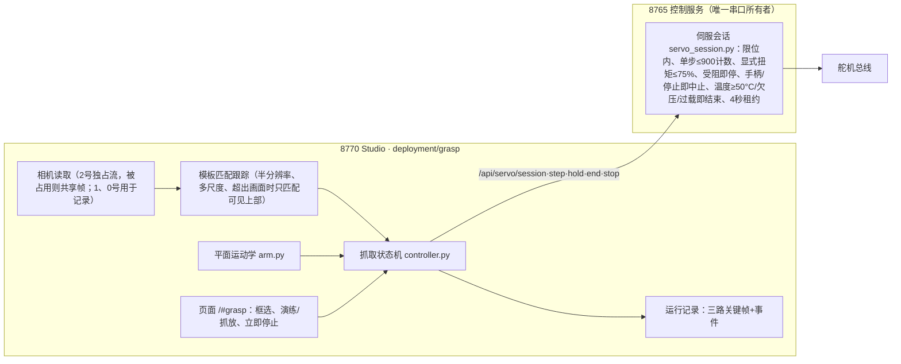

# 腕部视觉快速抓取：经验总结、加速方案与实现

日期：2026-11-03。用户要求：总结今天抓取充电器插头的经验，准备加速方案——用实时画面实时分析、移动手臂快速定位、抓起和放下，尽量脱离或少用大模型；设备已关，先做好准备，开机后再实测。本文是设计与交付记录；第8节的实机测试在用户开机后进行。

## 1 今天的两轮实测给出的约束

| 实测经验（证据） | 设计决策 |
|---|---|
| 第一轮插头在够取范围外，闭合只会把它推走，负载始终为0（L-040） | 推进前用平面模型检查伸展余量；推进中逆解失败或肘弯过小即停止，报告“超出够取”，不靠闭合把物体拢进来；不动底盘 |
| 夹爪下倾约55°时，指身在插头处高于机身，三次提起都沿插头滑脱；改为下倾约15°、指尖离桌约1.4cm水平推进后成功（L-041） | 推进姿态固定为近水平（腕俯仰合成角105°）、离桌1.4cm，从物体前方水平送入 |
| 在物体旁边张开会把它推移（g04→g05） | 只在观察位张开；下降前要求物体下沿在指尖前方 |
| 每次助手运行开始/结束都会把夹爪目标对齐到当前位置，夹紧力消失（`_cleanup`写回目标） | 新增控制服务“伺服会话”：一个会话内连续多步，目标与夹紧持续；清理只在会话结束时做一次 |
| 每张照片要重开相机5–8秒，每步来回20–30秒，一次抓放用了约70次运行、1.5小时 | 8770持续读取腕部视频流（15帧/秒）实时跟踪；关键时刻直接存流里的帧 |
| 45%–75%扭矩下肩部下垂20–47计数，实际抬升约为指令一半 | 每步之后按舵机回读重新计算；提起用单关节抬肩（全扭矩、向上进入空旷区），判断用实际转角 |
| 物体进入两指后下半部超出画面、被夹爪遮挡，跟踪尺度偏小 | 物体下沿到达指尖行后，按模型距离再插入3cm（今天实测约3.5cm），画面判据只作辅助 |
| 桌面是白色，背景位移不可靠；头部/右腕画面会因车身倾斜整体偏移 | 是否夹住用“夹紧时物体所在的腕部画面区域，在夹爪转过足够角度后是否保持原样”判断，与跟踪器无关 |
| 物体被推动时每档左移约10–15像素，卡紧后位移收敛 | 闭合：负载≥3%或物体被推动≥5像素记为接触；之后位移连续两档≤4像素、或夹爪落后目标、或接触后已收220计数即停，再加压55计数（<72计数受阻门槛） |

## 2 架构：8770判断，8765执行

- 8765只新增有界执行器，不含任何视觉判断；8770的通用代理不转发 `/api/servo`（测试覆盖），动作只能经抓取服务发出。
- 会话与助手运行、限位自检互斥；接管、采集、手动摆位中拒绝开始；会话中手柄任意输入立即停止；抓取端4秒不发送即结束会话并原地保持。

## 3 大模型的位置

| 环节 | 方法 | 是否用大模型 |
|---|---|---|
| 指定目标 | 人在实时画面上拖框；或“建议目标框”（边缘轮廓，排除贴边区域）后人确认 | 可选：只在人不在场时，助手看一张图给出框（一次） |
| 定位、对准、推进、闭合、提起核对、放下、收回 | 跟踪器+运动学+舵机读数+固定判据 | 否 |
| 失败复盘、参数调整 | 记录的关键帧与事件 | 可选，事后 |

## 4 流程与判据

| 阶段 | 动作 | 判据/参数（默认值来源） |
|---|---|---|
| 观察位 | 自动规划路径（收起→先展开肘→竖直→桌面上方高位→观察位后方4cm、上方5cm的预备点→前移落到观察位，逐段检查指尖/腕点不低于桌面+2.5cm；观察位指尖前方不允许低于观察高度，只有从更低处上升时例外）；单步>800计数自动分段；张开夹爪 | 观察位：指尖距肩23cm、离桌9cm、合成角108°。原为离桌6cm（h32），2026-11-03实测从前方划弧落到6cm时碰倒了立在指尖前方的插头（含插脚约5.5cm高），改为9cm并从后上方进入 |
| 对准 | 肩水平按横向误差修正，增益在线估计（初值−1.9像素/计数，今天约−1.6～−2.1） | 横向参考列随距离插值：下沿300行→x395，470行→x440（今天物体推进时右漂约50像素）；容差14像素、单步≤30计数 |
| 下降 | 先确认物体下沿<380行（离桌9cm观察位；原6cm时为335行，按腕部相机模型两者都对应下沿在指尖前约5cm），否则后撤2cm；分两段降到推进高度 | 桌面高度按模型−8.0cm（未尺量；页面可改）；推进离桌默认1.4cm，换桌后首轮演练可先用2.0cm并看右腕侧视 |
| 推进 | 水平推进，远2cm、近1cm；未到指尖前每步顺带横向修正 | 下沿≥360行记为“到指尖”，之后再插入3cm；逆解失败/肘弯<22°即“超出够取”；受阻即后退并停止 |
| 闭合 | 先快收到1960，再每档30计数 | 接触与卡紧判据见第1节；合到1450仍无接触为“空夹” |
| 加压 | 目标=当前位置−55，扭矩75% | 保持在同一会话 |
| 提起 | 只抬肩150计数（全扭矩） | 预期静止物位移=450×tan(实际转角)，需≥35像素；区域相似度≥0.75为夹住，≤0.5为留在桌上，之间补抬100计数再判；无纹理时退回跟踪框位移判据 |
| 保持 | 1.5秒，持续续约 | — |
| 搬运（可选） | 横移（肩水平换算）/前后移 | 页面输入 |
| 放下 | 肩部回到夹取值，扭矩45%，受阻视为已落桌 | — |
| 松开、撤离 | 张开到2000；抬肩撤离并记录“是否留在原处” | 同一区域相似度判据 |
| 收回 | 规划路径回竖直并合上夹爪（规范要求每轮结束收起或竖直）；可选回观察位 | — |
| 失败 | 不自动松手；指尖离桌<4cm则抬肩100计数离开桌面；结束会话 | 两次提起都未带起即停止 |

## 5 速度预算

- 今天：约70次助手运行、474张照片、约1.5小时（每步含开相机、计划上传、回执下载）。
- 新流程：仿真完整抓放约30个有界步骤；每步按舵机速度约0.5–1.5秒，加上帧到达等待0.12秒；预计实机一次抓放约40–60秒（待实测）。
- 跟踪：半分辨率模板匹配，工作端约数毫秒/帧；车载笔记本耗时待实测，页面显示中位耗时。

## 6 离线验证（无硬件）

- 控制服务执行器：模拟舵机总线7项测试（有界步、夹紧在后续步骤保持、会话结束才复位、限位/轮/超时/越步拒绝、受阻保持并继续、停止、租约与手柄中止、过温结束、HTTP接口、与助手运行互斥）。
- 抓取模块：仿真器（针孔相机+平面模型+接触/夹持物理，物体随夹爪转动）13项测试：完整抓放并放回原处、肩部下垂30计数加横移4cm放置、够不到、过矮空夹、中途停止、演练模式、跟踪精度、建议框、路径不低于桌面、服务校验与记录、路由只接受本机来源且不代理动作。页面Node测试1项。
- 用今天的真实腕部照片校验提起判据：h43成功提起0.968、h27留在桌面0.349、h44松手撤离0.448；h25两指沿插头滑脱时相似度0.987，但当时夹爪几乎没转，按“预期位移不足”判为需补抬，不会误判夹住。
- 以上是软件和离线证据，不代表实机已验收。

## 7 能力边界

- 目标框由人或一次大模型调用给出；模板匹配不认识物体类别，大幅转动、强反光、相似物体紧邻时可能跟错；跟丢即停止。
- 没有人员检测；开始前需确认运动范围内无人，运行中靠页面“立即停止”和手柄。
- 距离与高度来自模型和舵机读数，未尺量；桌面高度变化（换桌、车被挪到不同高度的桌前）需在页面修改。
- 只用左臂、只做桌面前沿附近、单个约3–4cm的物体；不移动底盘。

## 8 开机后的实机测试计划

1. **部署（无动作）**：笔记本开机后按附带脚本部署：逐文件哈希、运行目录基线核对、笔记本回归、只在“16电机齐全且静止”或“硬件完全不在”时重启服务，失败回滚。
2. **链路（无动作）**：开启相机，确认2号腕部流的帧龄、跟踪耗时；在画面上框选，晃动物体看跟踪；确认 `/api/servo/status`。
3. **观察位**：机器人收起或竖直、工作区无人时，点“到观察位”；照片核对夹爪高度与物体位置。
4. **演练**：模式选“演练：送入两指后不闭合”，核对对准、下降高度（右腕侧视看指尖离桌约1–2cm）、插入深度；必要时调桌面高度、横向参考。
5. **完整抓放**：同一插头抓起并放回；查看“提起核对”的相似度与预期位移；记录总时长和步数。
6. **重复与变化**：连续3次；横移4cm放置1次；记录失败原因。
7. 每次结果写入 `PROJECT_STATE.md`，新经验写入 `AGENT_LEARNING_ZH.md`（待审核）。

## 9 文件

- 控制服务：`fabrication/assembly/debug_console/servo_session.py`、`app.py`（`/api/servo/*`）、`test_servo_session.py`。
- Studio：`deployment/grasp/`（`arm.py`、`tracker.py`、`vision.py`、`controller.py`、`service.py`、`integration.py`、`sim.py`、`static/`、`test_grasp.py`、`test_page.cjs`）；`platform_app.py` 挂载，导航“快速抓取”。
