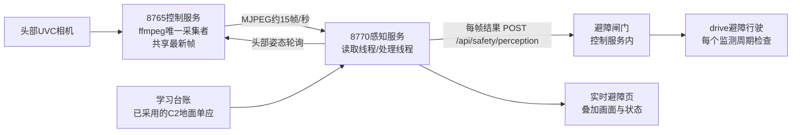

# 头部相机实时避障：需求、方案与落地

日期：2026-11-03（2026-11-02晚提出）。用户要求：视觉做实时检测，主要用于类似自动驾驶的实时避障；设计、落地、提交推送并部署。本文是设计与交付记录；实机行驶测试按第7节在用户准备好后进行。

## 1 需求

| 编号 | 需求 | 落地 |
|---|---|---|
| R1 | 连续检测前方障碍，不再依赖每次2–3秒的冷启动抓拍 | 常驻读取头部相机流，目标10帧/秒 |
| R2 | 给出可用于停车的距离，而不是“看起来有东西” | 地面单应标定后输出车宽走廊内净空（米） |
| R3 | 行驶中实时生效，像自动驾驶的自动紧急制动 | 控制服务内的避障闸门，行驶监测每个周期都检查 |
| R4 | 断流、卡顿、崩溃、未标定、头部被转走时不能误放行 | 所有异常都表现为“阻断”；消息超过350ms即视为过期 |
| R5 | 不破坏现有单一相机所有者和助手抓拍 | 感知订阅8765的相机流；相机被占用时助手抓拍和平台单帧改用共享帧 |
| R6 | 能看见、能复核 | 8770“实时避障”页：叠加画面、净空、处理耗时、闸门状态与阻断原因 |
| R7 | 笔记本算力内运行 | 320×240处理；JPEG按半分辨率解码；行人检测低频运行 |

## 2 为什么选“地面可行区”方法

车载只有普通RGB相机，没有深度或激光；笔记本是i5-8265U、约2GB空闲内存，不适合持续跑神经网络深度或分割模型。移动机器人常用的单目办法是**外观地面检测+地面平面几何**：

1. 用户确认车前近处没有障碍时，学习地面颜色（HSV直方图，低饱和度单列一箱，直方图平滑后取覆盖97%质量的颜色集合）。办公室蓝灰地毯两种颜色都能学进去，可在不同位置多学几次。
2. 每帧标出“不像地面”的像素，扣除车体遮罩（夹爪、手臂）。
3. 对每4像素一列从下往上找第一段连续非地面像素，它的最下沿就是障碍与地面的接触点。
4. 接触点经C2地面单应换算成以车体为原点的(x前, y左)米坐标，取车宽走廊（默认半宽0.24m）内最近值作为净空；没有障碍时净空为最远可视距离（默认1.6m上限）。
5. 最近3帧取最小值；任何一帧无效都要重新累积，宁可多停。
6. OpenCV自带HOG行人检测每0.5秒一次，脚部落在走廊附近也算障碍。车载OpenCV 5.0已不含HOG，因此在笔记本上该提示显示为“不可用”，人腿仍作为接地物体由第3步发现。

它能发现接触地面、颜色不同于地面的物体（椅脚、纸箱、桶、人腿、线缆堆）。**发现不了**：悬空的桌沿/抽屉、透明物、与地面颜色相近的物体、视野外和车后的东西。单目也没有可靠的高度信息。这些限制写在页面上，不能当作全场景安全。

备选与后续：工作端GPU可接神经网络分割/深度（经算力节点，只作增强，不进入安全闸门）；双目在观测姿态完成后可补充近距深度；长期主线仍是RGB-D/激光+Nav2（见导航方案）。

## 3 架构

- 感知服务在Studio进程里，避免图像计算占用控制进程的GIL和串口时序；控制服务只做轻量的消息校验与判断。
- 感知启动后头部相机由它独占；页面“设备与相机”的头部实时视频会提示被占用，单帧和助手抓拍自动改用共享帧（≤1秒）。

## 4 安全契约

避障闸门 `PerceptionGate.check(needed_m)` 放行的全部条件：

- 收到过感知消息，且最新一条在**350ms**内到达（按控制服务自己的单调时钟计）；
- 消息有效：地面模型已就绪、走廊在画面内且遮挡不超过50%、已连续3帧有效；
- 已有用户采用的头部地面单应（`metric`），且当前头部位置与标定时的导航姿态相差不超过25计数；
- 走廊净空 ≥ 剩余行驶距离 + 停车余量（默认0.12m）。

任一不满足即阻断。消息序号必须递增；感知停止时会发一条明确的阻断消息，即使漏发，350ms后也自动过期。

**drive 避障行驶**（助手动作接口新增）：单次0.05–0.6m，只能前进，原始轮速60–220；仍需60秒内头部+低位照片、边界编号、确认标记和单次使用的观察依据；开动前先问闸门，未放行不写任何非零轮速；行驶中每个监测周期（约30–50ms）检查一次，被拦按原停车三证据（双轮写零、关轮扭矩、200ms编码器稳定）停车，结果记为 `stopped_by: obstacle_gate` 的正常安全停车而不是故障。到期定时器、轮组状态/温度/电压/同步/无进展检查全部保留。后退仍只能用原有的 `travel` 原路返回规则。手柄遥操作本轮不受闸门约束，页面状态可作提示。

## 5 标定与使用流程

1. **C1/C2**：头部转到选定的导航姿态（建议略低头，近地面占画面大部分），平放棋盘格并量到车头中心的位置，算地面单应时带上 `head_pose`（`COM3:7`、`COM3:8`）；在“自主学习”页由用户采用。
2. **遮罩**：按实际夹爪/手臂在画面中的位置调整 `self_mask`（归一化多边形，API `/api/platform/perception/config`）。
3. **启动检测**：“实时避障”页点“启动检测”，确认叠加画面中绿色覆盖地面、黄线走廊位置合理。
4. **学习地面**：确认车前近处无障碍后点“学习当前地面”，可在不同位置补学。
5. **静态验证**（O1–O3）通过后，才使用 `drive`。

## 6 实现与验证

- 控制服务：`obstacle_gate.py`；`rotation_scan.bounded_drive` 与带闸门的监测循环；`agent_ops` 新增 `drive` 并让抓拍在相机被占用时使用共享帧；`app.py` 新增 `/api/safety/perception`。
- 感知：`deployment/perception/floor.py`（算法）、`service.py`（读取/处理/发布/学习/配置）、`integration.py` 与 `static/`（页面）。8770导航新增“实时避障”。
- 测试：合成相机渲染的蓝灰地砖地面上，0.8m处障碍测得0.80m；走廊外障碍不阻断；未遮罩的夹爪会被当作近处障碍（证明遮罩必要）；未标定/未学习永不输出距离；头部偏离、断流、停止均产生阻断消息；闸门的缺失/过期/无效/未标定/姿态/净空规则；带闸门行驶在通畅时到达、途中被拦安全停车、开动前被拦不写轮速、数据中途过期立即停车。

## 7 实机测试（待用户准备）

| 编号 | 内容 | 动作 | 通过标准 |
|---|---|---|---|
| O1 | 静止测距：在走廊中线0.4/0.6/0.8/1.0m放纸箱、椅子，卷尺对照 | 不动 | 误差≤5cm或≤8%，取大者 |
| O2 | 漏检与误报：走廊外物体、地毯颜色交界、阴影、线缆、人腿 | 不动 | 走廊外不阻断；记录漏检种类 |
| O3 | 端到端时延：画面中放秒表，对比叠加画面与闸门时间戳 | 不动 | 记录相机到闸门的实际延迟，必要时调大停车余量 |
| O4 | 低速避障行驶：前方0.8m放纸箱，`drive` 0.6m、原始轮速120 | 底盘 | 在净空≈余量处停车，停车证据完整 |
| O5 | 突然出现：行驶中把纸箱推入走廊；拔断感知（停止检测） | 底盘 | 被拦停车；停止检测后350ms内阻断 |

## 8 限制

- 安全依赖单目外观：地面颜色复杂、强反光或光照突变时误报会增多（只会更保守），同色物体会漏检。
- 只保护前方视野；盲区（车头前头部看不到的近距离）依赖“障碍从可视区进入”的假设，侧向突然伸入的物体可能来不及看到。
- 闸门和感知都在同一台笔记本上；系统整体冻结或断电仍需独立的失联保护（导航方案阶段B）。
