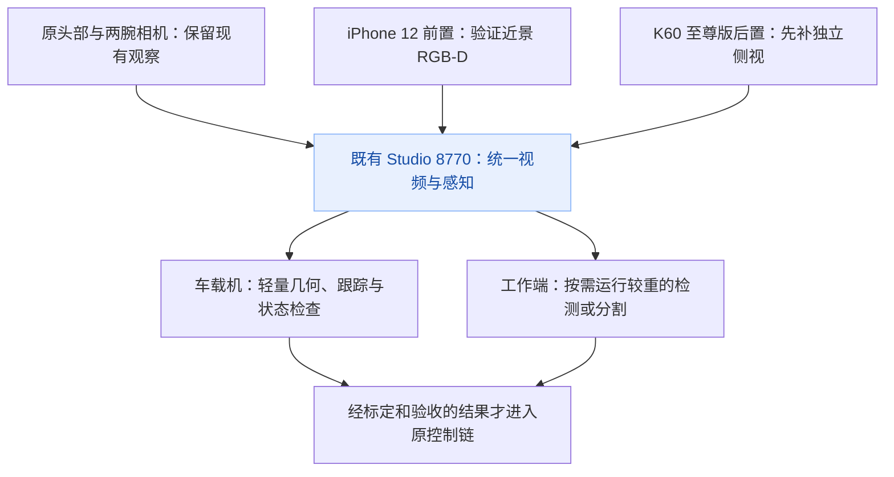

# 现有手机改善机器人视觉的方案

日期：2026-11-09。已确认型号：普通 iPhone 12（非 Pro）、红米 K60 至尊版（Redmi K60 Ultra）。本文依据用户陈述、当前源码、既有实测报告及本轮公开资料检索整理；没有连接手机、安装软件、采集新画面或驱动机器人。

**建议复用现有设备，先补独立侧视，再验证 iPhone 12 前置 RGB-D，最后考虑红米的 ARCore 深度与定位。保留原有头部和两腕相机。现阶段的主要问题同时涉及视角、距离、目标跟踪和标定，单纯增加像素不能全部解决。**

## 1. 现在究竟弱在哪里

- **抓取仍较依赖二维外观。** [腕部跟踪](../../deployment/grasp/tracker.py)使用多尺度模板匹配，[抓爪判断](../../deployment/grasp/vision.py)有绑定 640×480 旧视角的夹指区域和像素阈值。另有[独立特征连续性检查](../../deployment/grasp/flow.py)，但这些不等于物体三维位置、可靠遮挡分割或抓取姿态估计。换相机、裁剪、旋转、对焦变化后，旧参数不能直接沿用。
- **当前避障不是完整三维感知。** [地面感知](../../deployment/perception/floor.py)学习地面外观，结合地面单应标定估算接地点距离，实际处理尺寸为 320×240。源码明确说明：悬空障碍、玻璃、近似地面颜色的物体和视野之外的物体会漏检。高清输入有帮助，但不会自动消除方法的限制。
- **缺少稳定独立视角。** [11 月 9 日实测报告](RELOCATED_PRACTICE_20261109_ZH.md)区分了程序通过、离桌未知和侧视确认成功；还保留了车后中心、近轮区域的观察缺口，内置相机近乎全黑。该报告是历史实测，本轮没有重新取图。
- **算力应按机器分工。** [项目台账](../../PROJECT_STATE.md)记录车载机为 i5-8265U／约 8GB／MX250 2GB，工作端为 RTX 4060 Laptop 8GB 级。不能把工作端配置套到车载机，也不能由显卡型号推定已有 CUDA 推理环境。具体当前可用资源仍需实施时重新读取。

由此，优先改善的是“看得到、量得到、跟得住、确认结果”，而不只是“画面更清楚”。

## 2. 普通 iPhone 12 的前置摄像机能不能用

**能，而且值得验证两种输出：普通彩色视频，以及 TrueDepth 提供的实时深度数据。**

- **已核对的公开能力：** iPhone 12 前置为 12MP TrueDepth 相机系统；Apple 的官方示例展示了通过 AVFoundation 同步获取前置 RGB 和深度，并生成点云。[S1][S2] 这不是只能用于人脸特效的接口，可以读取画面像素对应的距离。
- **适合的角色：** 固定在车体上部或胸前，朝桌面／双臂工作区，试做局部三维观察：桌面在哪里、物体比桌面高多少、夹爪与目标还有多远，以及可见区域内的离桌变化。实际视野、精度和遮挡效果必须测。
- **需要分清：** 普通 iPhone 12 没有 Pro 型号的后置 LiDAR。前置 TrueDepth 的深度能力不能当成后置超广角的深度能力；12MP 是彩色相机规格，不是深度图规格。深度格式、分辨率、帧率和有效距离应由所用 App／API 实际枚举与测量。
- **不适合直接承担：** 全屋远距离测距、全向避障、透明杯／反光物／薄边缘的可靠测量、完全遮挡后的目标确认。主动深度也可能出现无效像素，强光和不同材料需要单独验证。
- **安装建议：** 普通 iPhone 12 官方重量为 164g，另需计入支架与线缆。[S1] 首轮固定在车体静止支架，避免直接增加腕部或头部云台的载荷。面向场景的是屏幕／刘海这一侧，不能按后摄安装方向装反，也不能遮挡 TrueDepth 组件。

### 实际接入路线

**优先用成熟 App 验证原始 RGB-D，再决定是否自研。**

1. **Record3D + USB 是可评估的现成路线。** 维护者明确提供 TrueDepth RGB-D 的 USB 实时传输及 Python／C++ 接收库，声明支持 Windows、macOS 和 Linux；Windows 文档列有 Apple 设备软件／驱动和构建依赖。[S3] 这说明存在公开接入路径，不代表当前 Windows、Python、iOS 和 App 版本组合已通过测试。
2. **费用和版本单独确认。** 官方站说明 Wi-Fi 实时流使用付费扩展包；App 当前价格、USB 功能授权和现有购买状态均未核实，不把此方案写成完全免费。[S4]
3. **自研是第二步。** 可按 Apple 示例获取同步视频、浮点深度与相机标定数据，再送入现有平台。iOS 自研构建需 Xcode／签名环境；现有台账没有确认可用的 Mac，不能默认只有 Windows 就能完成原生 App 构建。[S2]

普通摄像头软件传出的 RGB 视频、深度伪彩图或屏幕镜像，都不能替代数值深度。验收必须拿到深度数组、单位、有效像素信息和相机参数，并检查 RGB 与深度的几何对应关系。

## 3. 红米 K60 至尊版可以做什么

### 第一用途：后置彩色相机，补独立视角

优先把它固定在桌面斜侧方，能同时看见物体、夹爪和桌面接触处。它可用于独立判断实际送入、离桌、保持和放回，减少“腕相机看起来夹住了，但物体仍在桌上”的歧义。先试主摄，只有主摄覆盖不足时再比较其他镜头；不以最大像素模式或 4K 为起点。

接入可选择提供本地视频输出的安卓采集 App，或后续开发 CameraX／Camera2 采集端。选择软件时先确认实际提供的接口能被现有 Python／OpenCV 链接收；“能在会议软件里当摄像头”并不自动证明机器人后端可取流。USB 能否作为标准摄像头输出取决于设备固件／系统，不能仅凭 Android 版本下结论。

建议初始试验档位为 720p、15–30fps，或 1080p、15fps；这是待测配置，不是本机吞吐保证。测清晰度、最近可对焦距离、自动对焦漂移、端到端延迟和温升后再选择。固定场外侧视若用于度量，机器人移动后需要重新建立相机与车体的关系；只作结果观察也要确认工作区仍在画面内。

### 第二用途：ARCore 深度／视觉惯性定位，作为探索方案

**本轮核对 Google 官方设备表，确有 `Xiaomi | Redmi K60 Ultra | Supports Depth API`，不是拿 Xiaomi 13T 等近似型号代替。** 该条位于 Android（Google Play）设备表；同页另有中国区分发说明。因此还需验证这台国行手机当前 MIUI／HyperOS、Android 和 AR 服务的实际兼容性，不能由表格直接推定已能运行。[S5]

- Google 的 Depth API 主要通过运动中的多帧图像估计深度，可能融合设备已有的深度硬件；支持该 API 本身不证明配备 ToF／LiDAR。[S6] 本轮未完成 K60 至尊版完整相机硬件规格的官方页面核验，不追加未验证的传感器参数。
- 官方说明约 0.5–5m 是运动深度结果更准确的距离段，纹理、运动和场景会影响质量。[S6] 不能把它直接当成夹爪最后几厘米的精确测距。
- 可以探索固定在车体上的后摄与 IMU，向平台输出相机位姿、跟踪状态和算法深度，辅助局部空间理解；相机坐标到车体坐标的标定、漂移、跟踪丢失与会话重置仍需处理。
- 原生 App 可以拿到的 ARCore 数据，不等于普通网页或普通视频流自带这些数据。先验证服务与 API，再设计接入。

这条路线排在独立侧视和 TrueDepth 后，作为可行性实验；不提前许诺可直接替代完整导航感知。

## 4. 建议的设备分工与三档方案

### A：最快改善当前抓取判断，优先做

- 保留头部与两腕 UVC 相机，继续承担原有视角和近爪观察。
- 红米 K60 至尊版放在固定斜侧方，专门看目标、夹爪与桌面之间的关系。
- iPhone 12 先在台架验证前置 RGB-D 输出，暂不让验证结果直接控制动作。
- 收益：先获得独立可复核的抓放结果，并找出近景究竟是清晰度、遮挡、尺度变化还是跟踪问题。代价主要是固定、取流和小规模适配；可能有支架、线材或 App 费用。

### B：增加局部三维视觉，推荐的下一步

- iPhone 12 固定在车体上部、朝工作区，提供局部 RGB-D。
- 红米保持独立侧视；原腕相机继续看两指包覆，避免用一台相机同时承担定位与自证成功。
- 先做桌面平面与物体高度，再做三维目标位置；完成标定后才考虑接近过程的距离修正。深度不可见时继续保留原有观察与停止处理。
- 收益：从二维框迈向有尺度的局部几何；局限是可见范围和近景深度质量，不等于全屋三维覆盖。

### C：增加移动观察与局部空间能力，后续实验

- 在不执行桌面抓取时，可把红米移到车体低位后侧，验证后退方向与近轮区域的可见性；重新固定就重新核对视角与标定。
- 或让红米后摄朝行进方向，验证 ARCore 深度／位姿，辅助前方空间理解。
- 现有两款手机不能同时提供独立侧视、低位后视、前方 ARCore 和近景 TrueDepth 四个完整视角。若要长期同时覆盖，应先量出盲区，再决定是否复用其他已确认手机或添置专用设备。
- 不把段间看图、手机位姿或单个前向深度图称为全向自主避障。车后、侧向扫掠、悬空障碍和转身包络分别验收。

推荐拓扑：

## 5. 软件应怎样一起补强

1. **把“物体”和“自己的夹指”分开。** 先用固定背景／标记板和已有空爪图像做可验证的自体遮挡处理，再评估轻量检测／分割。工作端可评估较重模型，车载机保留轻量跟踪；不承诺当前硬件上的特定帧率。
2. **把有尺度的几何接上。** 对每个固定镜头保存内参、畸变、图像旋转／裁剪、相机到车体／桌面的变换；移动头部或机械臂上的镜头还要处理关节姿态。RGB-D 必须处理颜色与深度的配准，不能仅把两张图缩成相同尺寸。
3. **把结果分阶段验证。** 找到目标、接近、进入两指、闭合遮挡、实际离桌、释放留桌分别记录依据。深度／侧视／夹爪读数互相补充，模板分数高不再独自证明抓起。
4. **保留来源与时间。** 数据应携带源设备、镜头、采集序号、采集时间与时钟换算误差；RGB-D 另有深度单位、有效像素、内参／变换版本。置信度图只有 API 实际提供时才使用，不伪造；没有深度或过期数据要明确表示未知。不同手机没有硬件同步，不能直接拼成可靠双目。

全部接入继续使用 [既有 8770 Studio](../../.cursor/rules/robot-platform.mdc)，在同一应用增加采集适配、感知路由与设备状态。8765 仍是唯一串口所有者，手机传感器和工作端模型均不直接发电机命令。手机采集协议可以有内部传输连接，但不另建用户入口站点或开机平台。

## 6. 先做哪些验证，才能决定是否值得继续

下列是拟议验收方法和目标，不是已获得的测试结果。

1. **手机状态与取流，先静态验证。** 记录两机系统／App 版本、相机组件状态、线材、取流方式和分辨率。iPhone 验证真实数值深度；红米验证实际后摄画面，ARCore 另做支持能力查询。持续运行约 30 分钟，记录断流、重连、重复帧、延迟与温升。
2. **iPhone 深度台架。** 用尺具和多个平面／哑光物体，在 20、30、50、80、100cm 等距离采样；这些是测试点，不是宣称其有效量程。每点计算测距偏差、帧间波动、目标区域无效像素率，加入黑色、反光和遮挡对照。先找出可信工作区，再根据抓取剩余间隙决定误差是否可接受，不先许诺毫米级。
3. **红米侧视台架。** 在固定画面中验证空爪、触碰未提起、确实离桌和释放四种状态能否清楚区分；初期用人工核对的小批标注建立真值。普通自动对焦／防抖引起的画面变化也应计入观察。
4. **时间与坐标。** 验证 RGB 与深度时间对齐、手机与主机时钟映射，以及图像点到车体坐标的误差。初步可把 RGB-D 至少 10fps、端到端源龄 p95 不超过 200ms 作为评估目标，最终是否进入闭环仍由实际控制速度和停止余量决定；不因此放宽已有源龄保护。
5. **随后才做任务对照。** 冻结对象、摆位、姿态、光照和算法版本，分别比较原链、增加侧视、增加深度的结果。真实运动按已有控制规则执行，独立核对离桌、保持和释放；小样本用于诊断，不宣称已证明长期成功率。移动观察另设场景，不和抓取试验混为一个成功率。

**投入顺序：固定支架／光照与侧视 → iPhone 原始 RGB-D → 坐标标定与自体遮挡 → 三维辅助抓取 → 红米 ARCore／移动空间实验。** 当前尚无证据需要立刻采购新相机；若上述测试发现无法覆盖的距离、视野、稳定性或材料问题，再按测得的缺口选专用 RGB-D 或其他传感器。

## 7. 资料与证据边界

公开来源于 2026-11-09 查阅：

- **[S1] Apple：** [iPhone 12 Technical Specifications](https://support.apple.com/en-us/111876)。前置 TrueDepth、RGB 规格、重量和后摄配置。规格不等于机器人测距验收。
- **[S2] Apple：** [Streaming depth data from the TrueDepth camera](https://developer.apple.com/documentation/avfoundation/streaming-depth-data-from-the-truedepth-camera)。明确说明实时逐像素距离、同步 RGB／depth、点云和热状态管理；深度格式按设备能力选择。
- **[S3] Record3D 维护者：** [跨平台 RGB-D USB 接收库与说明](https://github.com/marek-simonik/record3d)。TrueDepth、USB、Python／C++、Windows 支持及依赖为维护者声明，当前机器组合未测。
- **[S4] Record3D：** [产品网站](https://record3d.app/)。说明 Face ID／LiDAR 设备支持及付费 Wi-Fi 扩展；未核实本地 App Store 的当前定价。
- **[S5] Google：** [ARCore supported devices](https://developers.google.com/ar/devices?hl=en)。本轮读取到 Android（Google Play）表中 `Xiaomi | Redmi K60 Ultra | Supports Depth API`；中国区另有 AR 服务分发说明。设备表支持与这台国行系统运行成功分开记录。
- **[S6] Google：** [Depth adds realism](https://developers.google.com/ar/develop/depth)。说明运动深度、可选硬件融合、设备支持、较佳距离段及纹理限制。

补充检索缺口：小米旧版 K60 至尊版规格地址重定向至错误页；安卓 USB 摄像头及第三方 RGB 采集软件的两份补充网页访问结果未知，已停止相应浏览器操作。没有据此判断手机不支持，也没有将未读内容作为证据。K60 的完整镜头参数、固件输出接口、AR 服务现状，以及两机实际延迟、热稳定性、深度误差均待真机核验。

本轮完成的是方案与资产台账更新；没有实机兼容结论，没有改动控制阈值或审核规则，没有完成采集端、平台适配或视觉能力部署。
