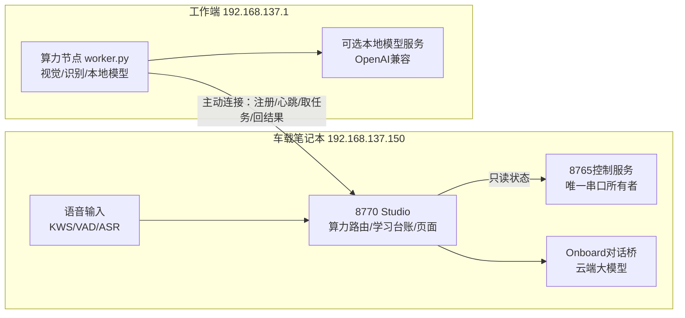

# 自主学习、双目抓取与算力协同：需求分析与总体设计

日期：2026-11-02。用户要求：翻查仓库在建图和移动驱动上可复用的方法；为明天“双臂腕部相机做双目测距与抓取”准备资料、学习方案和测试设计；评估车载笔记本与工作端（本机）算力，设计大模型、本地小模型、语音对话的分配与网络通讯；归档、提交推送后开发、部署到笔记本并完成不动机器人的测试。机器人实机测试明天由用户准备好后再推进。

本文是设计基线。实测数据、部署结果和失败记录在交付时追加到 [交付记录](DELIVERY_ZH.md) 与 `PROJECT_STATE.md`。学习方法与实验目录见 [学习方案与规范](LEARNING_PROTOCOLS_ZH.md)，明日实机步骤见 [机器人测试方案](ROBOT_TEST_PLAN_ZH.md)。

## 1 需求分析

### 1.1 用户要什么

1. **提高建图和移动的健壮性与可用度**：把仓库已有经验整理成可执行方法，补上缺失的度量手段，减少“看得见却量不准、走了却不知道走了多远”。
2. **明天开始双目测距和抓取**：两只腕部相机组成可变基线双目，先求距离，再引导手臂抓取。需要资料、方法、标定工具和测试设计。
3. **由助手驱动学习**：开始时多依赖大模型判断以保证可用，过程中沉淀“轮速—距离”“手臂出力/速度—到位误差”“相机怎么用”等可复用模型，并逐步把可靠部分交给本地快速算法。
4. **算力分配平衡**：笔记本内存小、CPU弱；工作端CPU/内存/显卡较好，可跑本地小模型；云端大模型质量最好但慢。需要评估各层能做什么，设计弹性路由，包括语音对话。
5. **全流程交付**：需求、设计归档、提交推送、开发、笔记本部署与测试；实机测试准备到位。

### 1.2 功能需求

| 编号 | 需求 | 验收依据 |
|---|---|---|
| F1 | 算力节点注册：工作端作为可选算力节点，声明能力、资源、在线状态 | 8770页面和接口能看到节点、能力、心跳年龄 |
| F2 | 计算任务路由：按能力、时限、节点健康把任务送到笔记本/工作端，超时与失败可回退 | 任务有完整生命周期记录；工作端离线时可回退或明确失败 |
| F3 | 视觉计算能力：图像质量、标定板检测、相机内参标定、双目标定与三角测量、视差深度、标记检测、基准测试 | 合成数据回归误差达标；两节点实测耗时入档 |
| F4 | 语音/语言能力接入点：工作端faster-whisper识别、OpenAI兼容本地模型（存在时）| 有服务时实测，无服务时如实报告不可用 |
| F5 | 学习台账：实验协议、样本、真值来源、模型拟合、候选/已采用版本、审核记录 | 拟合与晋级规则有测试；页面可查看 |
| F6 | 从实机运行导入数据：读取助手运行回执中的轮组计数、关节读数、照片 | 导入只读、ID校验；与真值配对后可拟合 |
| F7 | 标定资产：可打印棋盘格、标记板，尺寸可核对 | 文件按物理尺寸生成并核验像素 |
| F8 | 明日测试设计：每项实验的步骤、停止条件、真值、样本量与通过门槛 | 文档与页面一致 |

### 1.3 非功能需求

- **安全不外包**：停车、限位、唯一串口所有者、接管优先、观察时效都留在笔记本控制服务；任何远端结果只做建议，过期即作废。
- **弹性**：工作端睡眠、断网或被用户占用时，笔记本功能照常；远端只是加速和增强。
- **单一平台**：功能挂在既有8770 Studio，不新增用户站点、端口或开机服务（`.cursor/rules/robot-platform.mdc`）。工作端节点主动连接8770，不在工作端开放入站端口。
- **笔记本资源上限**：新增常驻内存≤300MB，同时最多1个重计算任务，保留≥1.2GB可用内存给控制、语音、浏览器展示。
- **证据真实**：每个学习样本记录来源、真值类型、时间和运行编号；失败和离群保留不删；模型不能放宽硬性安全限制。
- **私有数据不入Git**：令牌、照片、样本、模型权重、运行状态留在本地私有目录。

### 1.4 不在本轮范围

- 不驱动机器人；明天实验也仍走现有受限动作接口和逐段授权。
- 不安装数GB的本地大模型权重或CUDA版PyTorch；设计接口并在服务存在时自动启用（安装需另行确认时间和磁盘）。
- 不重写另一会话已交付的语音输入；只设计并提供可选的工作端识别/本地模型接入点。

## 2 仓库已有的建图与移动经验：怎样用来提高健壮性

| 方法 | 出处/证据 | 用法 |
|---|---|---|
| 唯一串口所有者+io锁，USB序列号识别控制板 | AGENT_CONTROL第2节，L-007 | 所有动作走8765 HTTP；新增功能只读状态或提交受限步骤 |
| 停车三证据：双轮写零、关闭轮扭矩、200ms编码器跨度≤2计数 | L-018，`rotation_scan.py` | 每段移动后必须取得，作为“已停”的唯一依据 |
| 写非零前先建立本地到期定时器；分段而非连续 | L-031、L-035 | 任何底盘原语沿用；学习实验每段独立回执 |
| 按编码器计数停车，不按时间 | L-031（短脉冲启动损耗）、L-035 | 距离实验以计数为自变量，地面真值另测 |
| 动作中监测模式/扭矩/温度/电压/双轮同步，异常立即停 | L-035，`travel` | 温度跳变等异常保留原始寄存器，专项复现后再判断 |
| 观察时效：60秒内头部+低位照片、姿态未变、依据单次使用 | L-031，`agent_ops._advance_evidence` | 每段动作前重拍；学习数据引用对应观察编号 |
| 本地接管后让出控制并使地图定位失效 | L-032 | 学习会话检测到接管即中止，样本标记为中断 |
| 设计几何≠实际：轮径/轮距需实测 | L-019、L-035 | 由W2/W3实验拟合有效轮径和轮距，带置信区间 |
| 地图追加式版本、未知不通行、人工复核不解锁动作 | 空间观察 | 新增的度量信息作为新版本观测追加 |
| AprilTag站点、执行租约、独立监督、足迹与速度门槛 | NAVIGATION_PLAN | 本轮补充度量标定工具，为阶段C/D铺路 |
| 共享相机帧：已有MJPEG所有者时不重复打开UVC | `camera_snapshot.py`，L-015 | 计算任务从助手抓图或共享帧取图，不直接开相机 |

### 新增的健壮性方法（本设计引入）

1. **地面单应标定**：导航头部姿态固定后，把棋盘格平放地面并测量它到车体的位置，求出图像到地面平面的单应矩阵。此后照片上任何“接地点”（障碍底边、红线、地面胶带）都能换算成以车体为原点的厘米坐标，红线范围可以变成真正的度量边界。计算量极小，笔记本即可完成。
2. **轮—地模型实测**：架空空转测“原始轮速→计数速率”，落地测“计数→地面距离”和“左右差→转角”，得到有效轮径、有效轮距、启动延迟、停车滑行量及其离散度。
3. **视觉复核位移**：每段移动前后用地面单应比较同一地面特征点的位移，与编码器估算对比，检测打滑和计数异常。
4. **异常专项复现**：对57°C温度跳变这类读数，安排静止高频采样、低速运动采样和双读确认，保留原始字节，分清传感器/通信异常和真实发热；排查期间保护照常生效。
5. **测量不确定度传播**：每个拟合模型带残差标准差，规划时把不确定度加到安全余量，而不是用平均值贴边。

## 3 双臂双目测距与抓取

### 3.1 仓库现有资料

- 机械臂运动学：`fabrication/assembly/debug_console/upstream_teleop.py` 采用SO-101两连杆平面模型（上臂0.1159m、前臂0.1350m），提供 `forward/inverse`，已有参考姿态与限位（AGENT_CONTROL第5节）。
- 相机：三路640×480广角UVC，头部=0号、右腕=1号、左腕=2号（实测）；腕部相机看得到自己的夹爪，10cm内对不上焦，手臂竖直时只看到天花板（AGENT_OBSERVATION）。
- 视觉示例：`software/examples/3_so100_yolo_ee_follow.py`（YOLO11检测+末端跟随，单臂，Linux/独立串口，需适配）。
- 学习路线：ACT、SmolVLA、pi0.5、RL文档与RoboCrew LLM代理（`docs/*/software/getting_started/`），平台已有ACT/SmolVLA实验配置生成。
- 仓库**没有**双目标定、深度、手眼标定或抓取规划实现；本设计新增。

### 3.2 难点与对策

| 难点 | 影响 | 对策 |
|---|---|---|
| 两相机装在两条活动手臂上，基线随姿态变化 | 每次姿态都需要外参 | 一级：固定“观测姿态”，在该姿态直接做双目标定；二级：手眼标定+正运动学，任意姿态推算 |
| 舵机齿隙/回程误差（L-033见几十计数跟随差） | 回到观测姿态后外参漂移 | 观测姿态从同一方向接近；每次测距前检查重投影或标定板残差；不合格即重标或拒绝测距 |
| UVC无硬件同步、自动曝光不同 | 运动中两图不同时 | 只在机器人静止时拍；记录采集时刻；目标静止才测 |
| 广角畸变 | 远处像素误差放大 | 先做单相机内参（含畸变），再做双目 |
| 抓取时手臂移动，相机也跟着动 | 抓取过程中双目失效 | 先在观测姿态求目标基座坐标，再用单腕相机做近距离视觉对准，最后靠夹爪位置/负载确认 |

精度估计（用于设计门槛，非实测）：焦距约300px、基线约0.25m时，视差误差0.5px在0.4m处约1mm，在1m处约7mm；实际误差主要来自外参漂移，目标是0.3–0.6m范围误差≤1cm，再由近距离视觉对准补偿。

### 3.3 抓取流程（分级）

1. **观测**：双臂到观测姿态（腕部相机朝前下方、视场重叠），头部低头监看；拍左右腕、头部图。
2. **找目标**：首期由大模型（助手看图）给出目标在两图中的像素位置和描述；本地用极线约束/模板匹配精化对应点；有标记时直接用标记角点。
3. **测距**：校正后三角测量，输出相机坐标、深度不确定度、左右重投影误差；不合格拒绝。
4. **换算到基座**：一级用“标定板放在已测量的车体位置”得到相机→车体变换；二级用手眼+正运动学。
5. **接近**：在目标上方预抓取点停下（低扭矩、受阻即停），单腕相机居中目标，逐步下降。
6. **抓取确认**：夹爪闭合位置未到全闭且负载上升=夹住；抬高少许后重拍确认；失败保留现场并记录。

## 4 算力评估与分配

### 4.1 实测硬件

| 节点 | 处理器 | 内存 | 显卡 | 现有推理环境 |
|---|---|---|---|---|
| 车载笔记本 SASA-LAPTOP | i5-8265U 4核8线程 1.6GHz | 8GB，空闲约2.1GB（Studio、Onboard、Edge展示及常驻软件占用） | MX250 2GB，未配CUDA推理 | OpenCV 5.0、numpy 2.4、sherpa-onnx 2.0.1；无psutil/onnxruntime/torch |
| 工作端 ASH-LAPTOP | i9-13900HX 24核32线程 | 64GB | RTX 4060 Laptop 8GB（桌面应用已占约4.4GB） | OpenCV 4.11、faster-whisper 1.2.1+ctranslate2（可见CUDA设备1个）、PyTorch 2.6 CPU版；无Ollama/llama.cpp |
| 云端大模型 | — | — | — | 车载已有常驻对话引擎；短答约3–5秒，复杂任务数十秒（DIALOGUE_LATENCY_AUDIT） |

工作端本身也是用户的日常笔记本电脑，可能睡眠、断网或被占满，因此只能当作“可用就加速”的弹性资源。

### 4.2 三层分工

| 层 | 适合做 | 不该做 |
|---|---|---|
| **车载笔记本（实时层）** | 控制与安全、编码器监测、相机采集与压缩、标定板/ArUco/AprilTag检测、地面单应换算、颜色/阈值分割、单点三角测量、低分辨率视差、现有唤醒词/VAD/流式识别、结果有效期校验 | 本地大模型、高分辨率稠密深度、神经网络连续推理、训练 |
| **工作端（加速层）** | 大批量标定求解、全分辨率视差、批量基准、faster-whisper GPU高精度识别、本地小型语言/视觉模型（OpenAI兼容服务）、后续YOLO/分割/深度网络、ACT训练（需CUDA版PyTorch） | 直接控制电机、承担停车判断 |
| **云端大模型（理解层）** | 场景理解、目标识别与描述、任务规划、抓取成败判断、给学习样本打标签、复杂对话 | 高频闭环、避障实时判断、作为距离唯一依据 |

语言模型可行性：工作端剩余显存约3.5GB时适合3–4B量化模型（如Qwen2.5-3B/Qwen2.5-VL-3B），7B量化模型可用显存+内存混合但速度下降；笔记本不部署大模型。

### 4.3 路由策略

每个计算任务带 `capability`、`deadline_s`、`route`：

- `local`：只在笔记本执行（安全相关的结果校验、轻量检测）。
- `prefer_worker`：工作端在线且能力满足就送过去，离线、超时或失败则在截止时间内回退到笔记本；笔记本也不支持时明确失败。
- `worker_only`：只有工作端能做（GPU识别、本地模型）；离线直接返回不可用，调用方改用云端或跳过。
- 结果绑定输入图像的采集时刻，超过调用方给出的有效期即视为过期，不能用于动作决策。

## 5 网络通讯架构

- **方向**：工作端节点主动连接笔记本8770（热点内网，8770已只允许工作端访问），注册能力后长轮询取任务、提交结果。工作端不开放入站端口，笔记本不新增端口。
- **认证**：笔记本私有配置生成随机令牌，经SSH复制到工作端私有目录；请求头携带令牌，常量时间比较；令牌不进Git、不出现在日志。
- **协议**：HTTP JSON；图像以base64随任务下发，单任务≤6MB；长轮询最长20秒；心跳2秒，6秒无心跳判离线。后续流式识别/逐字输出可在同一应用内升级为WebSocket。
- **任务租约**：任务派发给节点后有租约期限，超期未回则作废或回退；结果写入前核对任务编号和节点编号，迟到结果丢弃。
- **故障**：断网、节点崩溃、令牌错误、负载过高都只影响加速能力，不影响控制服务和动作安全；页面显示节点离线原因和最近延迟。

## 6 语音对话的算力分工

| 环节 | 默认 | 增强（工作端在线） | 说明 |
|---|---|---|---|
| 唤醒词/VAD/流式识别 | 笔记本sherpa-onnx（已交付） | — | 低延迟、离线可用 |
| 最终文本复识别 | 不做 | faster-whisper GPU复识别整句，置信度高时替换 | 截止时间约1.5秒，超时保留本地结果 |
| 指令理解 | 白名单命令本地匹配 | 本地小模型做意图分类/短答（≤2秒） | 不涉及动作授权 |
| 对话回复 | 云端大模型（已交付常驻引擎） | 本地模型做离线兜底 | 质量优先走云端 |
| 语音合成 | 云端MiniMax（已交付） | 后续可接本地TTS | — |

与已交付语音模块的接入只通过8770算力接口调用，不改动其采集、租约和半双工规则；接入由语音模块维护方另行启用。

## 7 平台落地

- 新模块 `deployment/autonomy/`：`compute.py`（任务/节点/路由）、`capabilities.py`（各项能力实现）、`resources.py`（无psutil的资源读取）、`stereo.py`（标定与三角测量）、`learning.py`（学习台账与拟合）、`protocols.py`（实验目录）、`worker.py`（工作端节点）、`integration.py`（挂载到8770）、`static/`（页面）。
- 8770导航新增“自主学习”，以平台同源内嵌视图展示算力节点、任务、实验目录、学习模型和标定资产；接口前缀 `/api/platform/autonomy/*`。
- 车载数据目录：平台数据下 `autonomy/`（令牌、任务记录、学习会话、样本、模型版本、标定结果），不进Git。
- 可打印资产：`docs/autonomy/assets/` 中的棋盘格与AprilTag标记（按毫米尺寸生成）。

## 8 实施与验收

1. 设计归档并推送（本文及两份方案）。
2. 开发模块与测试：合成数据验证标定/三角测量/拟合/路由/回退/令牌/超时。
3. 部署到笔记本：仅更新Studio文件并重启Studio，不重启8765控制服务；验证页面与接口。
4. 工作端节点连通实测：注册、心跳、视觉任务、识别任务、离线回退、延迟与两节点基准。
5. 归档实测结果，更新台账，提交推送，同步笔记本完整源码。
6. 明日实机：按测试方案逐项执行，学习结果进入台账，经审核后才晋级为可用模型。
