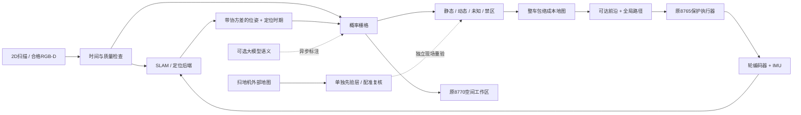

# 具体实现设计

状态：P1工作端已知位姿回放阶段已实现，结果见[验证与交接](VALIDATION_ZH.md)；P2–P5尚待按门槛推进。以下数字是**工程起始配置或验收目标**，不是现有硬件已达到的规格或历史参数自动晋级。

## 1 目标、输入与系统组成

最终验收：在同一Studio选择建图任务后，本地程序持续接收新传感器数据，定位、记录墙体/障碍/未知、选择可达观察位、按原控制保护执行有限动作，场景变化后重规划；重启可加载地图并重新定位；网络/大模型断开不影响本地停车。房间名称可晚于几何地图生成。

数据链：

第一阶段只实现Q/G/F/E/U的回放与预览部分；S由已配准的外部位姿输入占位，X保持断开。规划返回路径不表示执行许可。

## 2 传感器路线及安装

### A：优先评估的扫地机式2D主干

- 标准USB/UART二维激光雷达，候选驱动为SLAMTEC `sllidar_ros2` (S31)。采购前验证具体型号、原始扫描协议、量程/近盲区/角度分辨率、USB供电与Windows/WSL驱动；目前未知实际型号、价格和可用性。
- 雷达尽量安装在与底盘刚性连接、无遮挡、不会被臂爪扫到的固定位置。安装高度由现场确定；单平面只能观察该高度的障碍截面。
- 增加/核验独立IMU，轮编码器作运动先验。手机IMU只有在时间同步、外参和实际输出字段经过验证后才可代用。轮径与轮距均应实测，不能采用旧三轮URDF或未经验证的默认值。
- RGB-D保留为近场/不同高度障碍层，辅助桌沿、臂爪、低矮物与动态人；跌落、玻璃、细线缆需要专门传感/现场门槛，雷达本身不能保证识别。

### B：只用现有手机的条件路线

- 输入必须有米制数值深度、对应RGB内参、深度尺度、置信度语义、源时间戳、连续相机位姿或能运行视觉里程计的图像。
- 当前普通iPhone12的前置TrueDepth与后置LiDAR不同；无线`record3d_hue_video`没有直接等价于原始浮点深度/逐点置信度。固定视野TSDF只是局部表面。
- 红米AR重启/人工移位建立新session/epoch；异常远深度、全零、原始置信0和旧帧保留拒绝原因。`TRACKING`与正值覆盖率不能替代测距尺量。
- 若通过标定，优先独立RTAB-Map RGB-D/视觉里程计进程，再发布机器人基座位姿。若不通过，B保留为观察工具，主干转A；不用模型想象缺失尺度。

### 标定工序

1. 用已知尺寸标定板校核内参/畸变，记录图像裁切旋转；深度在0.3/0.5/1/2/3m等可用点位尺量，多材质、重复试验，保留无效点。
2. 传感器刚性固定，测量`base_link → sensor`平移和旋转，校核俯仰；头部转动传感器需把当时关节外参纳入，不能用固定外参。
3. 直行与原地/方形路线估计轮径、轮距、符号、打滑；绝对舵机位置先按周期展开，跨零和丢包单列断点，不能把控制目标速度当实测里程。
4. 在同一主机接收时使用单调时钟；远端源通过会话内时钟映射，记录网络延迟和不确定度，禁止直接减不同机器墙钟。

## 3 坐标、时间与状态契约

- 右手系：`x`向前、`y`向左、`z`向上，距离m、角度rad；二维地图数组为`cells[y * width + x]`，原点为左下角，图像显示才翻转y (S07/S08)。
- `odom → base_link`连续；`map → odom`允许闭环校正。`map`下的闭环跳变不能当底盘瞬移；旧扫描按优化位姿重投影，不能只移动机器人图标。
- 每组有`session_id / epoch / sequence / stamp_s / frame_id / calibration_id / source`。人工搬车、重新安装手机、跟踪丢失后重启不跨epoch融合；旧图保留。
- 扫描位姿与扫描时间偏差初始上限100ms；位置标准差初始上限0.10m，航向标准差5°。超限、非有限值、来源/坐标时期不同直接拒绝，而不是调高阈值掩盖故障。
- 实时采集目标：扫描5–10Hz，里程计20–50Hz，IMU50–100Hz，局部代价更新5–10Hz；以实际硬件CPU/链路测量决定。保存源帧龄和处理延迟；第一阶段回放时间不是当前新鲜度证据。P1采用一帧一个已知基座位姿；真实旋转扫描需按LaserScan逐束时间、IMU/里程计插值去畸变，或使用经过验证的静止采样，不能把整圈扫描的终点时间当作所有束同时发生。
- 状态机：`uninitialized → mapping → localized`；失跟踪转`localization_lost`并停车；重定位仅重新计算变换，不重发旧控制目标。用户pause/stop与物理hold有独立持久状态，地图恢复不解除它们。

## 4 里程计与SLAM后端

差速积分：`ΔsL = rL ΔφL`，`ΔsR = rR ΔφR`，`Δs=(ΔsR+ΔsL)/2`，`Δθ=(ΔsR−ΔsL)/b`。用圆弧/中点积分更新x/y/yaw并传播轮噪声协方差；轮估只作先验，打滑/卡轮不能用更多积分修复。

A后端：ROS2受支持发行版 + SLAM Toolbox (S05/S06)，扫描、TF、里程计先在只读bag中验证。保存原始bag、位姿图序列化与栅格/YAML；同一地图重新定位用相同标定和session关联。其软件元数据声明`LGPL-2.1-only` (S36)，作为独立进程接入，不复制源码混入新模块。

B后端：RTAB-Map RGB-D/视觉里程计 (S15/S16/S33)。先验证真实同步的RGB、depth、camera_info/IMU与实际外参，记录回环、失跟踪比例和CPU。ORB-SLAM3作研究对照，其代码GPLv3 (S34)及纯视觉纹理依赖需要独立评估；没有理由把它当当前默认可用驱动。

Windows负责现有Studio/8765硬件所有者；SLAM可用独立本机工作进程或WSL2工作进程。工作进程没有独立用户站点/开机服务，生命周期归原Studio管理。先只发布只读地图和位姿，不能让ROS `cmd_vel`直接占用串口。WSL联网、USB转接和CPU开销必须现场验证；本轮不安装/启动车载ROS或另开传感器所有者。

## 5 概率栅格

真实传感器阶段分辨率初始5cm，100m²房间约4万格；P1合成回放默认10cm，可选2.5–20cm、有界地图最多400×400格，超边界报缺口，后续再做分块扩展。每格维护占据log-odds、是否实际观察与最近观测时间，同一扫描不重复累计证据：

`L_t(c) = clamp(L_(t−1)(c) + logit(p(c | z_t,x_t)) − logit(p0), Lmin,Lmax)`。

起始`p0=0.5`、命中增量+0.85、穿越−0.40、饱和±4.0。离散类别：`L≥0.60`占据，`L≤−0.50`自由，其余为不确定；从未观测始终未知。数值仅为初始实验参数。

- 有限有效测距用射线穿越更新自由，真实命中端点更新占据；同一扫描同一格最多一次更新，命中优先，防止密集重叠射线虚增置信度。
- 无回波只有传感器明确声明“量程内没有命中”才可在量程内清除；缺测、NaN、置信度不足和未拍区域不清除。超地图边界截断不在边框制造假墙。
- 传感器原点必须在地图内，扫描必须落在有效范围/时间/标定/位姿质量约束内；整组校验完成后再更新，拒绝不留半张地图。
- 静态建筑层长期保留；动态障碍使用独立近场滚动层及有界时效，障碍过期回未知或请求复看，不能按时间自动变成自由。禁区/跌落边缘是持久不可走层。
- 低质量深度/语义分割最多形成待核验障碍候选；语义模型无权把占据或未知改成可走。

RGB-D转换补充：先按内参把有效深度反投影到传感器系，经标定外参到基座/地图系，用已验证地面平面估计高度；按实际整车高度划分低障碍、主体和桌沿/上层扫掠层，点云体素初始3cm。某条朝地面的深度射线不能证明其上方整列体积为空；仅有孤立点/缺失高度层时只增加障碍候选，不清除该体积。P1暂不提供未经标定的手机点云→自由空间快捷转换。

## 6 成本地图、前沿与路径

P1以保守圆包络预览：现有`body.profile()`的粗略转动半径0.55m只是工程假设，额外裕量及实际包络都显示来源；参数不能小于当前预览假设来“钻过去”。后续实测多边形投影覆盖托盘、头、折叠双臂、线缆、万向轮，再使用姿态相关扫掠。

构造可走集合时，对**障碍、未知、不确定和地图外部**均按包络与半格对角线保守膨胀。A*只在膨胀后的已知自由中心移动，8邻域且禁止对角切角。P1路径是格点折线路径预览，不包含速度/加速度、转弯动力学或当前动态碰撞证明。

Frontier先在原栅格找自由/未知邻接边界并聚类；将候选观察位退到可达、膨胀后自由一侧。用一次Dijkstra/BFS求全部可达代价，计算候选附近的未知信息收益；`score = gain − λ × path_length`，加入定位风险、传感器视域与失败冷却后择优。候选与路径有稳定来源/地图revision，map改动必须重算。

死角、狭窄通道或定位退化：停止当前目标，选择已知安全区中的观察位/回退位，按新观测重规划。与真实机械/供电/通信故障分别分类；不解除原故障锁，不无限重试同一个frontier。停止条件包括无可达前沿、预算用尽、定位/源龄失败、用户pause及物理保护。

全覆盖留P4：房间分割/通道图→Boustrophedon分解→按有效感知/清扫宽度生成有重叠往返条带→用局部规划连接条带→记录真实经过覆盖掩膜。外部扫地机房间分区是候选，不证明XLeRobot能通过其门洞。

P3局部跟随先评估差速适用的受调节Pure Pursuit：按路径弧长选择前视点，曲率限制速度，近障碍与定位不确定度增加时减速；前视距离初始0.3–0.6m、速度目标不高于0.05m/s，最终还须与原接口限值取更严值并实测轮速映射。每段先检查完整扫掠；独立停车距离满足`v × 最坏延迟 + v²/(2 × 实测减速度) + 余量`。DWB/MPPI为动态复杂场景的后续对照，不在未经车载CPU/制动试验时替换原执行保护。房间分割先用自由格距离变换/形态学通道检测与分水岭，再建房间邻接图；房间ID按版本间区域重叠跟踪，名称可人工或大模型补充，几何通路由本地算法核验。

## 7 外部扫地机地图

P1提供**先验专用**导入契约，不共享实时占据数组。建议先接受Valetudo v2地图的`size/pixelSize/layers`等公开格式 (S22)，兼容Dreame数据时按版本做独立adapter并保存原始hash，绝不把不同格式的像素类别直接通用解释。

Valetudo公开格式坐标/尺寸用cm、原点左上；转换成m与左下原点时显式翻转y，墙优先于房间覆盖，缺失格保持未知。Dreame解码器有`grid_size / dimensions.left/top / pixel_type / segments / robot_position / charger_position / virtual_walls / no_go_areas`等字段 (S24)，单位、方向和版本必须逐项核对。

地图用于：查看平面拓扑、建议房间次序、候选门洞、禁区与先验匹配。不得用于：直接控制XLeRobot、复用扫地机位置为本机位置、把扫地机自由格标成本机已验证自由、凭栅格生成真实3D家具尺寸。

配准：至少3个不共线公共锚点，以带反射检查的SE(2)最小二乘/RANSAC估计旋转和平移，已知尺度则禁止随意缩放；未知尺度时单独标记估计值。检查锚点残差、独立留出点、地图时期与现场变化，残差目标≤10cm后也仅能成为几何先验；仍需本机对全身高度与动态障碍重验。家庭地图默认只在本地，不进入Git或外部模型调用。

## 8 原平台接入、存储及并发

- 模块放`deployment/fieldmap/`，API挂`/api/platform/fieldmap/metric/*`，页面加入既有`/#fieldmap`；同一8770应用的独立只读/回放页可用于离线检查，不增加用户站点或服务。
- 独立目录`<fieldmap_data>/metric/<session_id>/`保存session元数据、逐帧输入和可重放结果。现有map.json、照片、历史轨迹、手机模型及复核文件不改写。
- 会话ID由服务生成。每次修改携带`expected_revision`，文件锁内重新加载并比较；并行旧revision拒绝。新帧采用连续sequence与单调时间，source/epoch/标定不可悄悄改变。
- P1落地采用独立`metric/metric.sqlite3`，SQLite事务同时保存原始扫描、hash与revision，`BEGIN IMMEDIATE`拒绝并行旧版本；这替代研究初版的逐文件原子写入设想。读取在一致快照中重放，内存缓存最多4个版本；每会话256帧、10份外部先验，最多100会话，达到预算拒绝继续并保留旧卷。CLI每次生成新的输出卷，不覆盖旧卷。不把损坏元数据/日志当空地图继续运行；重放出错保留原文。
- 控制入口、驱动写入、原停止/物理hold与本模块解耦；网络失败或导入第三方地图不产生扭矩/轮速/唤醒命令。Origin、JSON大小、维度、射线数、累计帧数、文件尺寸与路径均有预算。

## 9 阶段、验证与退出条件

P0（本次先归档提交）：核对当前代码、资产、WSL接入和一手资料；形成来源账本、可实施设计与未解决清单。

P1（随后开发）：已知位姿的确定性栅格/前沿/规划回放 + 外部先验隔离 + Studio界面。用合成非家庭环境及独立期望验证：墙体命中/遮挡、缺测不清空、epoch/时戳拒绝、窄门阻挡、无对角穿墙、不可达frontier、并发/重启/损坏保留、API源限制及“零控制调用”。不调用大模型，记录固定输入的输出hash与耗时。

P2（真实传感器/定位）：当前设备恢复并获准维护后，先同步操作规则，完整设备/故障状态核验；标定，录只读bag，再离线评估后端。建议初始门槛：可用测距误差中位≤5cm且P95≤10cm（量程/材料分层）、时间配对P95≤100ms、局部更新P95≤200ms、回放实时因子≥1。达不到时修改传感器/链路，不能直接降低阈值。

P3（受保护建图）：在空旷可观察区域有限直行/转弯，按独立尺量与闭环比较评估；目标重复回到标记点位置误差≤10cm、朝向≤5°，错误闭环0、旧时期误融合0。动态人员与源断流均通过原控制链停车。物理hold/轮组故障未消除前不进入此阶段。

P4（多房间与覆盖）：测试窄门、低矮/悬空障碍、动态家具、重复纹理、搬车重定位、断网/重启；报告可达区域的真实新增覆盖、漏区、失败/未知完整分母、最长无进展时间与人工接管次数。覆盖率分母从独立测量或人工复核真值获得，不能来自算法自己画出的自由面积。

P5（持续运行）：在多个独立场次重复验证、保存地图版本及回放，比较“纯本地基线”和“可选语义辅助”；核心循环大模型调用数应为0。失败、耗时和未见区域纳入报告，完成一小块不写成全屋已验收。
