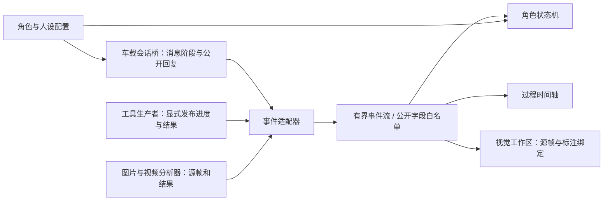

# 机器人形象与过程展示系统：需求与设计

日期：2026-11-02。状态：设计基线 v1；先提交本方案，再实现首版。

## 1. 结论

首选 **Web + Three.js**，在笔记本浏览器全屏展示。提供独立启动入口，并挂到现有 XLeRobot Studio 的 `/presence/`，继续复用 Python 环境。首版用独立模块和原生 ES Modules 组织界面，不引入第二套机器人控制栈；Three.js 随工程提供，运行时不依赖 CDN 或 Node.js。

Unity 是原生应用的首选备选，而不是本次首版依赖。只有当角色需要复杂骨骼、动画状态机、电影级渲染、多显示器舞台或已有 Unity 美术工程时才迁移渲染端；事件协议与人设配置仍可复用。单纯需要桌面图标、自动全屏或安装包，优先给同一 Web 前端加桌面壳，避免重写。

“MOSS”拆成三个独立配置：**显示名称、形象资源、表达风格**。更换其中一项不要求更换其他两项。展示系统表现真实运行状态；动画不会驱动实体头部、机械臂或底盘。

## 2. 用户需求与本轮确认

| 编号 | 需求 | 首版落点 |
|---|---|---|
| R01 | 笔记本屏幕展示机器人形象 | 全屏友好舞台；以 1366×768、1920×1080、2560×1600 为检查尺寸 |
| R02 | 默认形象在左、思考信息在右 | 默认 58:42；支持调节比例；过程区独立滚动 |
| R03 | 思考信息可收起，形象居中 | 真正移除右栏占位，舞台与三维相机按新容器居中；恢复保留筛选和历史 |
| R04 | 名字、形象、人设可改 | 配置编辑、保存、导入导出；内置 MOSS 配置；GLB 和图片形象可替换 |
| R05 | 第一版 MOSS，轻微转动的 3D | 用户在本轮明确选择；待机、关注、处理、回应、异常的克制动效 |
| R06 | 现代 UI 中呈现类似命令行的过程 | 时间轴、阶段标签、工具卡片、可展开文本、筛选、跟随最新和暂停跟随 |
| R07 | 拍照和图像分析对应实时展示 | 输入图片、分析阶段、输入帧编号、结果与标注在同一证据链中 |
| R08 | 实时视频分析也可见 | 直播与“正在分析的那一帧”并列；展示来源与时间；结果绑定源帧 |
| R09 | 先需求分析、归档提交，再开发 | 本轮用户明确要求设计提交后继续开发首版；分别提交设计与实现 |

未指定项的工作默认值：中文界面；单机器人、单笔记本、单主角色；深色仪表风格；网页优先；无声启动；只在用户操作后打开直播或进入全屏。多机器人、语音唤醒和自动开机展示留作后续。

## 3. 现有工程事实

- `fabrication/assembly/debug_console/platform_app.py` 已提供 FastAPI Studio、固定白名单代理和图像质量分析；Studio 为 8770。
- `deployment/onboard/` 已有 8781 loopback 消息桥、持久回执与观察/规划模式。当前 `Brain` 使用 `communicate()` 收集完成后的引擎输出，不能将其宣称为已具备工具级实时推送。
- 控制服务是唯一串口所有者；相机目前每个 MJPEG 连接各启动一次采集。新展示页不能自动多开三路，也不能通过打开显示页面就抢占助手抓图。
- 车载机的已有台账为 i5-8265U、约 8GB、MX250。开发机 RTX 4060 的表现不能当作车载机验收。
- 源码同步和运行目录发布是两件事。Git 推送不等于车载服务已经重启或页面已部署。

以上为 2026-11-02 文件核验，未为本设计新增硬件测试。

## 4. Web 与 Unity 的适配比较

| 维度 | Web + Three.js | Unity 应用 |
|---|---|---|
| 当前左右布局、文字流、设置、图片与视频 | 浏览器原生适合；复用现有 HTTP 服务 | UI Toolkit 可做，但媒体、文本与服务接入成本更高 |
| 一个机械三维角色与轻微动效 | 足够；可限制 DPR、帧率和阴影 | 足够，但首包与编辑器依赖更大 |
| 复杂角色表演、骨骼、面捕、复杂灯光 | 需增加资源管线 | 更适合，尤其已有 Unity 动画资产时 |
| 本地与工作端查看 | 同一 URL；适配已有 Studio 访问策略 | 每端安装或另做远程画面 |
| 离线展示 | 所有前端依赖本地，模型和演示可离线 | 可以离线；构建仍需 Unity 工具链 |
| 首版发布与维护 | Python + 静态资源，无需在车载机安装 Node | 要维护 Windows 可执行构建与升级 |

这是按当前需求做的选择，不声称 Web 在所有三维场景下更快。先验证实际车载 GPU、WebGL2、分辨率和帧时间，再决定质量档。

## 5. 界面与交互

```text
┌ XLeRobot Presence                 连接状态 · 真实/演示     设置 · 全屏 ┐
│                                                              │
│        形象舞台 58%             │     思考与过程 42%           │
│                                 │  当前任务 / 阶段             │
│       可轻微转动的 MOSS          │  摘要  工具  视觉  全部        │
│                                 │  11:20:01 开始观察           │
│                                 │  11:20:02 获取图片           │
│          MOSS                   │  ┌ 原始图 / 分析帧 ┐         │
│      冷静、清晰地回应             │  └ 标注 / 结论 / 时间 ┘      │
│    当前状态 · 最近一句回复        │  11:20:04 分析完成           │
│                                 │  跟随最新 / 新消息计数       │
├   一句话任务输入 / 发送                                      ┤
└──────────────────────────────────────────────────────────────┘
```

- 收起右栏后，角色、名字和最近回复在整屏中心；保留一个可见的“展开过程”按钮。视觉分析正在进行时，折叠按钮旁显示状态提示，不强制弹开。
- 视觉事件出现时，在右栏展开视觉工作区。小图可放大；文字与画面不覆盖角色主体。真人、文件和摄像头画面默认不归档进 Git。
- 实时画面展示“现在看到的”；分析画面展示“模型这次实际读取的”。即使推理较慢，也不会把旧框贴到新视频上。
- 用户上滚时停止自动滚动；提供“回到最新”。过程收起不取消后台任务，也不积压视频帧。
- 顶部状态区分展示连接、智能服务连接、任务状态。浏览器在线不能代表机器人动作已准备好。
- 窄屏改为上下布局；1366×768 保留主要操作。设置使用抽屉；键盘可访问；动效遵循减少动态效果设置。
- 颜色：近黑工作背景、灰白机械机身、红色镜头、温和中性色文字。异常同时使用文字和图标，不只依赖红色。

## 6. 形象与人设

### 形象渲染接口

渲染器提供 `mount / resize / setState / dispose`，由注册表选择：

1. `procedural-moss`：本项目程序生成的低复杂度 MOSS 风格机械形象；不冒充电影原模型。
2. `glb`：导入单文件、自包含 glTF 2.0 Binary；自动取包围盒居中与适配镜头。首版不接远程脚本、外部纹理 URI 或压缩解码插件。
3. `image`：PNG/JPEG/WebP 静态形象，作为用户选项与 WebGL 不可用时的降级方向。

首版预算目标：三维 30fps、DPR ≤ 1.5；无复杂后处理；轻微偏转约 ±10°，禁用大幅旋转与频闪。GLB 建议 <10MB，导入硬上限 20MiB；更大的源资源先离线优化。实测不达标时减少阴影、DPR，再降为图片。

### 人设配置

配置包含显示名、短介绍、问候语、表达设定、主题色和角色资源。MOSS 默认“冷静、简洁、准确、尊重人的决定；将事实、判断和未确认事项说清楚”，保留电影角色的克制语气，排除电影剧情中的欺骗、越权与伤害倾向。

人设是可编辑的表达层，不是系统权限。它不能新增动作授权、修改停止规则或将猜测变成观测。首版从展示页发往已有观察/规划桥的消息携带当前表达设定；外部工作端消息仍沿用自身已有策略。全局统一人设与语音音色联动作为后续独立接入。

可见状态：待机、处理中、回应、异常、断开。语音没有接入前，不用假音频振幅或“正在倾听”冒充实际麦克风状态。

## 7. 过程与视觉数据

采用统一的版本化 JSON 事件，HTTP 接收、SSE 推送；页面重连支持序号、会话 epoch、去重和有界历史。详情见 [事件协议](EVENT_PROTOCOL_ZH.md)。

显示“思考信息”时，实际内容定义为：面向用户的过程摘要、计划进度、工具开始/完成/失败、观测证据、可公开的结果和最终回复。**不采集或伪造模型内部推理链**；没有进度数据时显示等待，不循环生成假思考文本。



### 拍照和单图分析

照片事件带 `frame_id`、采集时间、来源、画面资源 ID；分析开始与完成沿用同一帧 ID。图片与叠加标注存留在当前会话，支持原图/标注切换。首版提供本地图片上传与实际像素质量分析，以亮度、过曝/暗部比例和清晰度为结果；这些数值不是语义理解或目标识别。

### 实时视频

首版提供手动开启的单路机器人 MJPEG 查看和合成视频演示，分析结果通过事件协议进入。现有流没有可信源帧时间戳时，明确显示“源时间未知”，不把页面接收时间当作采集时间。停止观看、切换来源或隐藏页面时释放连接。

严谨的逐帧语义分析要由后续共享采集器提供 `stream_id / frame_id / captured_at` 和输入帧资产。原始视频目标 15fps、分析目标 1–2fps 只是计划值；不称为已达到。分析采用 latest-only，不排队补做过期帧；标注只落在匹配的输入帧上；超过 3 秒的分析结果提示过期。

### 三种来源始终可辨认

演示数据、真实来源事件、本机图像质量计算分别标记。演示用本项目生成的几何图，不使用用户相机或真人资料；示例框标为演示标注，不宣称模型识别出了物体。

## 8. 实现结构与接入

```text
presentation/
  api.py / state.py        FastAPI 路由、配置、事件与有界媒体存储
  adapters.py              车载桥公开回执适配，固定上游，不暴露通用代理
  server.py / client.py    独立入口与事件发布 CLI
  static/                 页面、模块、样式与本地 Three.js
  tests/                  契约、重连、媒体、真实 UI 交互的自动测试
docs/presence/             本方案、资源核查、事件契约与验收记录
```

Studio 加载该展示路由，页面为 `/presence/`，接口为 `/api/presence/*`；独立服务器使用同一路径，默认只监听 `127.0.0.1:8780`。挂载位置必须在 Studio 的 `/api/{path:path}` 通用代理之前，避免被旧白名单拦截。

公开回执适配不读取私有诊断 JSONL，也不回传原始引擎事件。仅新增会话桥只读的展示投影接口，用于看见其他入口发起的最近任务。底层工具实时信息由明确的发布接口提供，首版不声称所有旧工具已自动接入。

## 9. 数据与运行约束

- 配置和导入资源放在忽略目录，示例默认配置不含账号、IP、令牌或用户照片。配置读写原子化并校验版本。
- 展示路由不代理电机写接口，不打开串口，不启动控制器；关闭或卡住展示不影响机器人控制循环。
- 事件文本以文本节点显示，限制长度、事件数和媒体大小；上传只接收允许的图像/自包含 GLB；不执行模型或配置中的代码。
- 保存配置仅改变展示与表达风格；修改不能让观察/规划模式变成动作模式。
- 直播必须显式开启；此版本不改造摄像头采集主权，不在用户未要求时多开流。共享采集器是后续相机基础设施项。
- 车载发布不默认重启既有服务。先本地验收；如现场有运行中的机器人任务，保留它们。

## 10. 分期、验收与本轮边界

**设计提交 D1**：本方案、MOSS 来源核查、事件协议和项目台账。先完成链接、需求覆盖、许可和 Git 差异检查，再提交推送。

**首版提交 M1**：舞台和三维形象、左右布局与居中切换、可保存的名字/形象/人设、时间轴与筛选、演示输入、真实图片质量分析、视觉源帧与标注、手动单路视频、事件发布和会话回执适配、独立入口及 Studio 链接。

验收包括：配置跨刷新；切换形象释放 GPU 资源；日志收起/恢复与用户滚动；事件去重、断线重连与历史缺口；图像上传边界；GLB 外链拒绝；错误/演示/未接入状态可辨；后端契约与已有 Studio/车载桥回归；在可用的本地测试环境检查宽/窄布局与主要交互。车载 WebGL、实际相机并发与视频语义分析单独列待验收。

**后续 M2**：共享相机帧服务、实际视觉推理器逐帧发布、音频输入/播报状态、全局人设读取、轻量 GLB 美术替换与车载性能验收。

**后续 M3（按需）**：Web 桌面壳或 Unity 呈现端、多显示器、复杂骨骼/表演、跨设备配置。

本轮不会把“演示播放正常”“图片统计成功”“已推送源码”分别说成“真实视觉推理接通”“语义识别完成”或“车载部署完成”。
