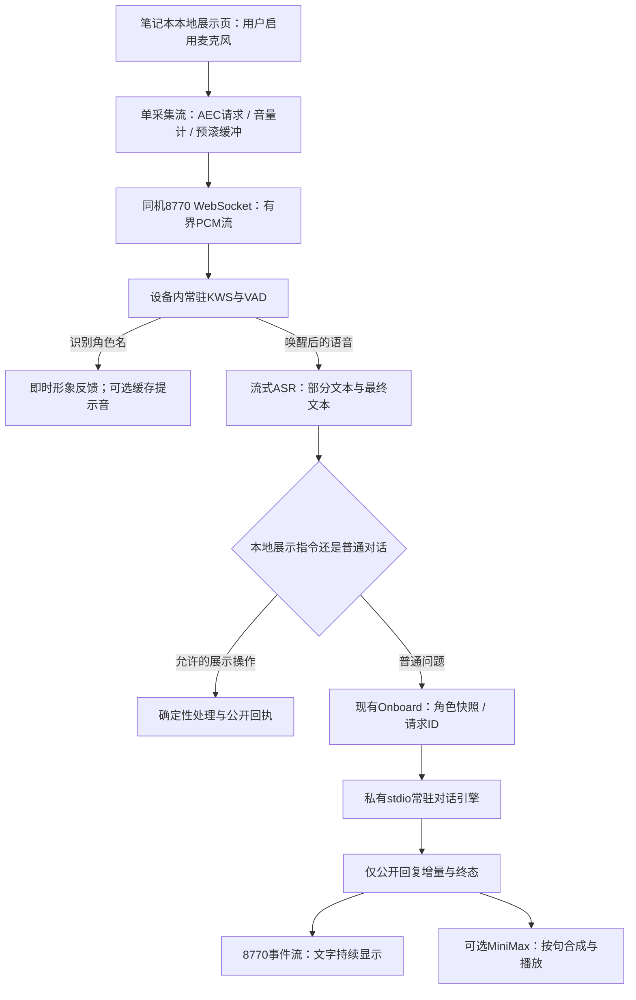
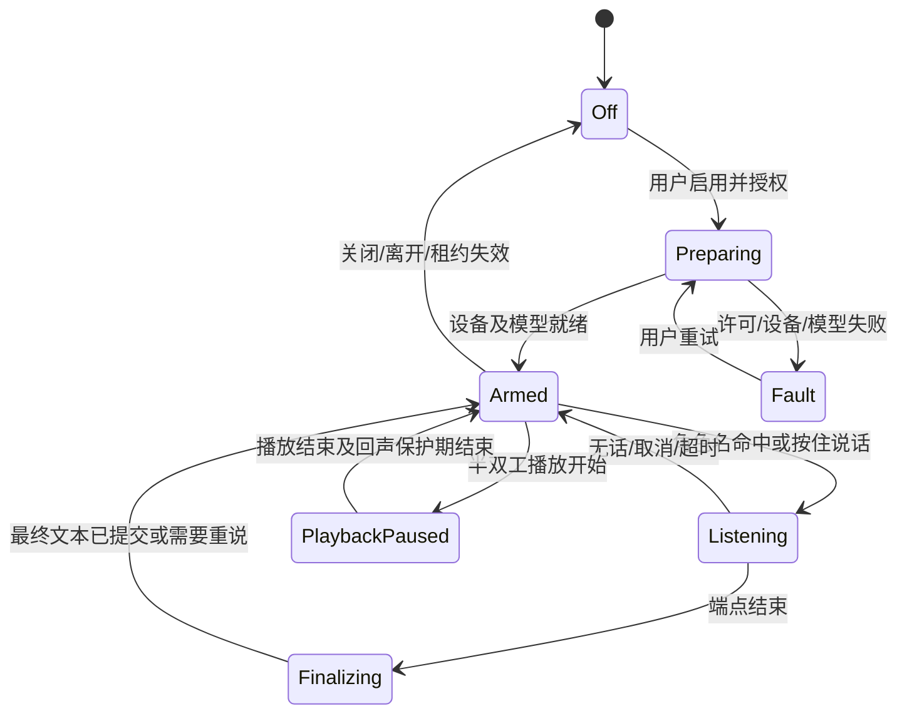

# 笔记本麦克风、按人设唤醒与低延迟对话设计

日期：2026-11-02。状态：**待用户审阅，未进入功能开发。**

建议首版沿用8770展示系统：笔记本本地展示页采集真实麦克风，设备内完成唤醒和语音识别，唤醒立即给出本地反馈；普通文字指令继续进入现有MOSS角色对话。深度对话从每轮启动CLI迁为既有Onboard托管的常驻stdio会话接口。两项可以独立实施，唤醒速度不再依赖大模型速度。

排查结论与原始口径见[对话耗时排查](DIALOGUE_LATENCY_AUDIT_ZH.md)，测量值见[脱敏证据](evidence/2026-11-02-voice-latency.json)。本文件中的新接口、参数、状态和指标均是**拟议设计**，不是已经上线的功能。

## 1. 需求分析

### 1.1 用户目标

1. 使用车载笔记本自身麦克风采样、接收语音指令，和当前文字输入共享角色、会话及公开过程展示。
2. 唤醒词跟随人设的**显示名字`Profile.name`**，当前为MOSS；以后改名后不需要重新开发，也不通过解析自由格式人设描述猜名字。
3. 喊名字后及时知道机器人听见了；指令接收、识别、处理和播报过程都能看见。
4. 排查并改善大模型对话慢的问题，明确CLI调度、模型等待、页面和语音合成分别占什么环节。
5. 保留文字持续输出、可修改人设、可选MiniMax语音播放。输入监听与声音输出各自可开关。
6. 所有能力继续进入现有8770平台。本轮先完成需求和设计归档提交，开发另行确认。

### 1.2 首版范围

首版包含手动按住说话、按角色名唤醒、单轮指令采集、实时/最终转写、角色回复、取消与可选播报。优先支持中文、MOSS的英语/中文常用读法，以及模型词表可覆盖的中文/英文自定义名字。

首版不以“语音指令”自动开通机器人运动。不新增底盘行驶、舵机控制、权限提升、声纹鉴权或会议录音系统；现有观察/规划限制继续适用。允许的即时本地操作限于展示与对话，例如停止播报、停止监听、取消当前回答、收起/展开过程面板。诸如“向前走”可以被转写和解释，但不得因此执行实体动作。

### 1.3 本轮确认的现实条件

- 笔记本为i5-8265U、约7.85GiB可见内存、MX250 2GiB。CPU轻量唤醒/ASR比在此机另挂7B本地接线员模型更适合首版资源预算；实际语音性能尚未测试。
- 只读枚举看到**Realtek麦克风阵列**为active，同时还有active的立体声混音和Pico虚拟麦克风。注册表active不等于实际拾音通过，也未确认哪个是默认输入；不能直接用系统默认设备后就声称采到了人声。
- Studio与Onboard现运行在Windows Session 0。不能由设备枚举推导为后台任务能可靠使用交互用户的音频设备。
- 当前展示独立页面`/presence/`已具备MOSS角色、文字输入、事件流和可选MiniMax播放；生产角色会话和工程会话已经分离。
- 已有记录与探测确认：队列等待约13–33ms；CLI轮次结束后另有约2.58–8.68秒进程收尾等待；常驻接口短回复仍约2.9–4.6秒。因此“唤醒即时反馈”和“语义回答完成”必须分别设计。

## 2. 参考仓库：采用什么，避开什么

只读参考`F:\workspace\voice-assistant-bridge`，提交`23bd95458706b2b13042554eb12fc5af2b083f54`。未启动其服务、未读取私有`config.json`凭据、未修改仓库。

| 参考点 | 源码实际情况 | 本项目取舍 |
|---|---|---|
| Windows GUI录音/STT | `windows_gui.py`有录音线程、按住/切换录音、本地缓存faster-whisper模型，CPU int8、beam_size=5 | 借鉴采集生命周期和手动输入兜底；整段Whisper作为准确率/兼容备选，不能据此承诺流式首字速度 |
| Windows CLI | `windows_client.py`的录音/持续监听路径仍提示需接STT | 不把CLI“能录音”当成完整语音指令已经实现 |
| Python唤醒 | `wakeword.py`默认Hey Jarvis，自定义词使用单独模型文件 | 不能仅改界面文字便当成任意人设名唤醒；窗口注释与字节量也需校准：16kHz PCM16下1280字节是40ms |
| Android采集/状态机 | PCM分发总线、静音门、唤醒状态和前台采集生命周期 | 复用单采集、多消费者、明确状态与冷却窗口的设计；Android代码不能直接作为Windows实现 |
| Android唤醒实现 | 一路是5秒音频分片送STT；另一路有两次能量突发的启发式触发 | 前者有分片等待，后者不证明说出了指定词；均不作为本项目低延迟、按名字唤醒的主方案 |
| 快速接收与深度处理 | README提到本地模型接线员；当前`server.py._local_stage`实际先接受转发、给固定短确认，再后台等待深度回复 | 采用“即时确认与深度处理分离”的现行模式，不额外等待一次本地LLM |
| 重试/恢复 | 参考仓库支持多次转发重试和恢复未完成请求 | 不迁入机器人指令链；延续现有原ID查询、不自动重放和故障锁定语义 |

不整体运行参考服务：其示例使用8765，与本项目唯一控制服务冲突。只借鉴模块和协议思路，不引入独立GUI、OpenClaw链路或第二套TTS。

## 3. 采集方案选择

| 方案 | 优点 | 前提与限制 | 决定 |
|---|---|---|---|
| 笔记本本地浏览器采集 | 直接复用展示页；权限可见；输入与播放在同一端；可请求浏览器回声消除 | 需要本机可信页面、用户许可和页面存活；后台/休眠须实测 | **推荐首版**，符合“笔记本屏幕展示”使用场景 |
| Windows原生音频工作进程 | 可为以后关闭网页仍监听提供基础 | 需验证交互会话、WASAPI、设备切换与播放回声；当前Session 0不能直接保证 | 第二阶段；仍由现有平台管理，不另开日常站点或端口 |
| 纯浏览器SpeechRecognition | 接入少 | 浏览器/网络/语言支持不统一，持续监听与设备内处理不可控 | 不作可靠唤醒基础，可保留为明确标注的实验适配器 |

首版笔记本打开`http://127.0.0.1:8770/presence/`采集。`localhost/loopback`具备浏览器可信上下文条件；现有`http://192.168.137.150:8770/`是普通LAN HTTP，不能假定`getUserMedia`可用。

远程工作端仍通过原LAN入口看状态、发文字和修改角色。远程页面不自动采工作端自己的麦克风来冒充笔记本麦克风。若以后要求远程浏览器也采音，需要单独选择设备角色和HTTPS方案；不建议通过关闭浏览器安全策略解决。

当前形象从Studio打开独立页，首版使用该顶层页面。将来若内嵌iframe，还需显式核对同源、Permissions Policy和`allow="microphone"`，不能只增加采集脚本。

## 4. 推荐架构



KWS/VAD/ASR使用独立工作线程或受平台托管的工作进程，不能在FastAPI事件循环或音频实时回调中执行推理。常驻app-server属于既有Onboard拥有的私有子进程，不新增可访问站点、端口或开机任务。

### 4.1 音频采样与资源

- 浏览器`getUserMedia`请求单声道、`echoCancellation/noiseSuppression/autoGainControl`，读取实际`getSettings()`；这些是请求，不能把`true`配置当作硬件AEC实测。
- 输入设备原生可能为48kHz等格式；使用有状态抗混叠重采样，再统一为16kHz、单声道、PCM16 little-endian。不能简单每隔N点取样或对每帧独立重采样。
- 推荐传输帧20ms：320个采样、640字节；1.5秒预滚约48kB。音频保持在内存，默认不保存WAV，不在唤醒前送到外部服务。
- 一个采集源同时提供音量计、KWS、VAD和ASR，避免分别打开麦克风。采用有界队列；空闲唤醒时允许丢弃过期帧并重置，指令中断帧则整条作废，不把可能缺少“不要”等词的残句提交。
- 初步资源目标：语音工作进程常驻内存不超过800MiB，空闲平均CPU占整机不超过5%，识别阶段尽量限制为1–2个推理线程。均为验收目标，需与3D形象/控制服务并行实测后调整。

### 4.2 设备选择与采集所有权

第一次显式启用时取得浏览器许可，展示可选输入设备和短时音量反馈，由用户选中Realtek实际麦克风阵列；不默认选立体声混音或Pico虚拟音源。

浏览器`deviceId`是设备/浏览器来源相关值，保存在采集端本地偏好中，不把另一台机器的ID写成全局默认。选定设备离线后提示重新选择，不能静默切到虚拟回放。

服务器只允许一个有效采集租约：`owner_id + capture_epoch`，建议1秒心跳、3秒失效。第二个窗口只观察或显式接管；旧窗口不得在重连后继续提交旧音频。关闭麦克风、失去许可、连接失效或退出页面时停止所有tracks、释放AudioWorklet和缓冲。后台页是否允许继续监听取决于实测；首版按前台/全屏展示使用，不能承诺关页、锁屏或休眠后仍工作。

## 5. 按人设名字唤醒

推荐候选为**sherpa-onnx开放词表KWS**，优先评估官方中英`kws-zipformer-zh-en-3M-2025-12-20`。官方说明允许在给定语言/词表内配置关键词而无需为每个词重新训练；这不等于所有语言、拼写和发音都自动支持。

流程：读取`Profile.name` → 规范化名字与可编辑发音别名 → 校验词表/生成token → 准备新关键词配置 → 原子切换 → 发布ready状态。MOSS默认候选为英语“MOSS”和中文“莫斯”；其他常用读法由用户试听/实说后增补，不能仅因字符串相近就宣称已支持。

- 中文名字、英文名字、数字缩写、标点/表情分别验证；不支持的名字明确提示设置可发音别名或使用按住说话，不偷偷保留旧名字继续监听。
- 改名字时取消尚未提交的采集、清空预滚并增加`profile_revision/capture_epoch`；新KWS准备成功后才显示“可唤醒”。已经提交的对话沿用提交时的角色快照，不重写历史。
- 检测包含置信度、VAD门控与建议2秒冷却；能量门只判断有无明显声音，不能代替词识别或说话人鉴权。
- 支持“莫斯”单独呼叫，也支持“莫斯，告诉我现在的状态”连着说；依靠预滚与词时间范围保留指令开头，只去掉句首已确认的唤醒片段，不全局删名字。
- 纯呼叫立即显示“我在听”；声音输出已开启时可播缓存短句“我在”。若用户已经连着说指令，优先继续采集，跳过提示音，避免自己盖住用户声音。

提示短句是单独可编辑的角色配置，不尝试实时解析任意自由格式人设来生成确认语。更改角色/声线后异步更新缓存；缓存未就绪时只给视觉反馈，不在唤醒瞬间请求大模型或MiniMax。未开启声音时不播放提示音。

## 6. VAD、识别与指令提交

主候选为同栈流式中英Zipformer ASR，配合轻量VAD与端点规则；具体模型文件、版本、许可证和SHA须在实施时确认并固定，本轮未下载模型。`faster-whisper small/int8`保留作按住说话或准确率对照；不要把每次5秒整段录完再识别作为实时唤醒主链。

建议初始参数：唤醒后5秒内开始讲话，尾部静音约400–600ms提交；单条最长20秒，超时自动结束并说明。过短、空文本、明显静音、断帧或识别失败不提交LLM。参数需要通过真实笔记本麦克风调优。

部分转写在界面持续替换、标“识别中”；只在`asr.final`后生成一个稳定`request_id`并提交一次。最终文字可查看/复制；低置信或可能改变含义的结果先请用户确认，不能从模糊转写猜测动作。

识别器若不提供可校准的置信度，就使用其真实质量标志、静音/断帧信息和人工确认，不伪造一个通用置信度分数。不同KWS模型的得分阈值也需分别标定。

确定性本地指令只做白名单精确匹配，例如“停止播报”“关闭麦克风”“取消当前回答”“收起过程”。不能用包含“停止”的任意字符串直接触发，也不能把“停止播报”误解释为改变电机扭矩。闭麦后不能再通过语音重新开麦，界面保留明确入口。

语音忙时最多保留一个尚未开始的语音轮次；需要替换当前回答时先显式取消，不能无限排队或默默丢弃已接受的任务。断网后保留已提交请求ID供查询，不重传旧指令或自动重放。

## 7. 状态、回声与打断



上图只表示输入状态。对话任务另有Idle/Queued/Thinking/Replying/Completed/Cancelled/Failed状态；声音输出另有关闭/待解锁/缓冲/播放/停止状态。三者分开：关闭麦克风停止新的采集，不取消已经接受的回答，也不修改声音输出开关；取消回答和停止播放各有独立操作，不隐含关闭实体机器人。

界面可同时显示“麦克风：等你叫我；对话：处理中；声音：关闭”，不能用一个总状态把三者混为一谈。展示输入音量、部分转写、最终文字和真实任务进展，不生成假思考日志。所有输入活跃状态均允许关闭到Off，Fault需显式重试。

首版默认**半双工**：长回复播放期间暂停自动唤醒/指令采集，播完增加约300ms回声保护，再回到Armed；页面停止按钮始终有效。因此首版不能承诺在大声播报期间靠一句话打断。

半双工暂停期间不把播放回声送给KWS/ASR，清空预滚并在恢复时重置识别状态；页面仍明确显示麦克风许可/采集与“唤醒已暂停”的区别。长回复生成期间若尚未播放，输入状态不必被模型占用。

第二阶段再验证全双工：使用同一浏览器采放链的回声消除，结合播放状态、VAD与KWS判断用户插话，先duck/停止输出，再接受新话。必须测试机器人自己说“MOSS”、电视人声、缓存确认音和不同音量，不能仅靠冷却时间宣称解决自唤醒。

## 8. 对话耗时的改造方案

### 8.1 三条不同速度的路径

| 路径 | 示例 | 处理方式 |
|---|---|---|
| 即时反馈 | 唤醒、进入倾听、停止播报 | 本地状态机/缓存音频，零LLM |
| 普通对话 | 问候、常规问题、简单状态解释 | 独立角色会话；先复用当前模型的常驻接口，后评估精简上下文与快速模型适配器 |
| 深度处理 | 工程分析、多步任务、明确需要工具的问题 | 现有深度代理能力及执行边界；先确认已接收，再显示真实进展 |

首版不在8GB笔记本上额外挂一个7B接线员；也不让另一个模型决定“有没有被唤醒”。如后续接快速API通道，使用正式配置和可用凭据，保留同一角色快照与权限规则，不抽取CLI登录令牌、不改全局账号设置。

路由优先确定性本地白名单，其余默认进入角色对话；明确需要工程工具的请求再进入深度处理。不为一次普通语音输入再串行增加一轮“分类模型”。

### 8.2 常驻引擎与流式公开回复

在既有Onboard中新增引擎适配边界，托管一个私有stdio app-server子进程：初始化一次；为展示对话创建/续接独立thread；每轮`turn/start`；按协议获取公开消息增量与终态。工程会话和角色会话仍分开。

目前只完成临时3轮问候诊断，不能直接把它当作完成生产迁移。实施必须处理：JSON-RPC响应与通知交错、请求ID匹配、进程树退出、超时、取消、故障锁定、thread持久化以及版本不兼容。新增能力通过适配器启用，保留旧CLI实现作受控回退；**不能在结果不确定时换适配器重发同一任务。**

公开流只允许角色回复：为`agentMessage`建立item/phase白名单，未知phase不播出，禁止把analysis/reasoning、工具原始输出或整个引擎JSON转发给页面/TTS。UI区分“正在生成”与“完成”，只有`turn.completed`且状态completed才记任务成功；failed/interrupted不冒充已完成。

不能仅在现有CLI代码里收到一段文字就提前当成功，也不通过粗暴杀进程来省收尾时间。首选用常驻协议消除“每轮等待进程结束”这一结构性依赖。

### 8.3 页面与播放

把Onboard公开事件主动接到8770现有journal/SSE，后台轮询只作恢复兜底；不再依赖前端每1.5秒拉取才发现回复。序列和事件ID继续用于去重，重连不补播旧音频。

优先预缓存“我在”等短确认语；普通回复从确认的公开文本中按句生成，TTS合成下一句时可播放上一句。后续再评估供应商PCM增量到浏览器播放队列，不能把当前“读SSE后收齐WAV”误称为已经流式发声。

声音关闭仍输出完整文本。停止、取消、切角色、隐藏或离开页面时递增`generation_id`并丢弃迟到音频。部分文字/音频已呈现但轮次中断时，明确显示“回答中断”，不能记为完整成功或重播补齐。

## 9. 拟议配置与接口

新增可选`Profile.voice_input`，旧配置缺失时默认关闭且读取不覆写。示意字段如下，具体命名在实施时以契约为准：

```json
{
  "enabled": false,
  "capture_backend": "browser-local",
  "mode": "wake-and-talk",
  "wake": {"follow_profile_name": true, "aliases": [], "cooldown_ms": 2000},
  "wake_ack": {"text": "我在", "audible": true},
  "utterance": {"start_timeout_ms": 5000, "endpoint_silence_ms": 500, "max_ms": 20000},
  "duplex": "half",
  "keep_raw_audio": false
}
```

`audible=true`还必须同时满足已有`speech.enabled=true`、浏览器已获声音许可、确认语缓存就绪；它不绕过用户声音总开关。输入开关关闭不影响文字对话，也不自行改动已有语音偏好。

| 同一8770应用内拟增路由/事件 | 用途 |
|---|---|
| `GET /api/presence/voice-input/status` | 已配置/实际就绪、采集所有者、模型状态与错误；不返回凭据或原始音频 |
| `POST /api/presence/voice-input/claim`、`release` | 采集端领取/释放短租约，校验来源和epoch |
| `WS /api/presence/voice-input/stream` | 同机PCM与控制帧；限格式、大小、速率、缓冲和单所有者 |
| `PUT /api/presence/config` | 保存输入设置和角色；设备ID仍为采集端本地偏好 |
| 现有消息入口及拟增单轮cancel | 最终转写提交一次、原ID查回执；取消只针对当前请求/turn |
| 现有SSE扩展 | `voice.status/wake/asr.partial/asr.final/reply.delta/reply.completed/cancelled/error` |

事件携带`request_id、turn_id、capture_epoch、profile_revision、generation_id、seq`中的相关字段。浏览器时间与服务端单调时钟不能直接相减；通过同钟阶段测量或握手校准分别统计，UTC只作关联。

音量、VAD、部分转写和字符增量使用内存广播、替换/合并更新，建议约100ms合并一次；不把每个20ms音频帧或每个字符都写入持久journal。只持久化有限的唤醒、最终转写、任务接受、终态与错误记录。远程观察端不接收原始PCM。

配置发布需先更新所有读取者的校验契约，再写新字段。必须覆盖旧配置、新配置、仅改无关字段和回滚读取；吸取之前严格schema拒绝新增speech字段造成503的经验。模型、原始音频、设备私有偏好和运行记录放在既有忽略的数据目录，不入Git。

## 10. 体验指标与验收

下列均为**目标，尚未经过真实麦克风验收**。预热/已授权条件与冷启动分开记录。

| 指标 | 初始目标 | 说明 |
|---|---|---|
| 唤醒词说完→视觉确认 | p95 ≤200ms | 模型已就绪，不经LLM |
| 唤醒词说完→缓存声音起播 | p95 ≤300ms | 声音开启、缓存命中且未继续讲话 |
| 讲话结束→语音端点提交 | 400–600ms | 不以固定5秒录音等待结束 |
| 端点提交→最终转写 | p95 ≤800ms | 本地模型目标，设备实测后决定是否达标 |
| 常规短答首个公开文本 | 先争取p95 ≤5s | 本轮同模型仅3次常驻试测，不能当p95；如要求更快再评估快速模型通道 |
| 停止播放→实际静音 | p95 ≤150ms | 当前播放端本地处理，不等模型返回 |
| 近距离安静环境唤醒命中 | ≥95% | 0.5–1m、人声样本；不由合成音频替代真实口音验收 |
| 空闲误唤醒 | 初始目标≤0.5次/小时 | 至少跨数小时背景人声、电视和TTS对照，样本不足不报达标 |

验收至少覆盖：MOSS/莫斯与两个自定义名字、同句唤醒＋指令、纯呼叫后无话、短暂停顿、长句、低置信、断帧、静音、设备拔出、虚拟音源误选、两个窗口争用、网络恢复、改名时采集、取消后迟到结果、声音关闭、播放自唤醒、页面后台/重开、CPU争用。

每类延迟收集足够样本后再报告p50/p95，并同时列出冷启动、失败率和样本数。保留原ID幂等、不中断控制服务、无自动动作/重放以及完整配置可恢复的回归。

## 11. 实施分期与评审点

1. **阶段A：采集与计量**。本机可信页面、明确设备选择、独占租约、音量计、按住说话、本地ASR、文字确认；补齐全链路时间点。此时先不开放自动唤醒。
2. **阶段B：人设名唤醒**。KWS预热、发音别名、改名原子切换、预滚/VAD、即时视觉及缓存确认音、半双工与真实误触测试。
3. **阶段C：缩短对话链路**。常驻引擎适配器、公开文本流、主动SSE、按句TTS和完整取消/恢复；与旧实现做相同问题集对照。
4. **阶段D：按效果增补**。只有前述指标不足或用户要求时，评估快速模型API、全双工插话、原生后台采集；不预先引入第二套复杂服务。

建议审阅时重点确认四项：首版以笔记本展示页保持打开为使用前提；输入监听默认关闭、由用户显式启用；名字允许配置发音别名；首版接受半双工，后续再做播报中语音打断。以上是本方案建议，不是用户已接受的决定。

本轮交付到设计归档、测量和提交为止，不因诊断成功自动进入采集或对话引擎改造。

## 12. 参考与验证边界

- [sherpa-onnx开放词表KWS官方说明](https://k2-fsa.github.io/sherpa/onnx/kws/index.html)：本轮实际读取，确认自定义关键词机制及中英模型条目；未下载或实测具体模型。
- [MDN getUserMedia](https://developer.mozilla.org/en-US/docs/Web/API/MediaDevices/getUserMedia)：本轮实际读取，核对可信上下文、用户许可和iframe约束。
- 本机引擎生成的`ThreadStartParams/ThreadResumeParams/TurnStartParams/TurnInterruptParams/AgentMessageDeltaNotification`等Schema和临时stdio探测，见私有证据目录；协议版本需要随生产引擎固定。
- 参考仓库的README、`windows_gui.py`、`windows_client.py`、`wakeword.py`、`server.py`及Android的`PcmDistributionBus/WakeAudioGate/PhoneAgentCaptureService`均做了源码核验；没有把技术备选文档或能量触发逻辑冒充已完成的精准名字唤醒。
