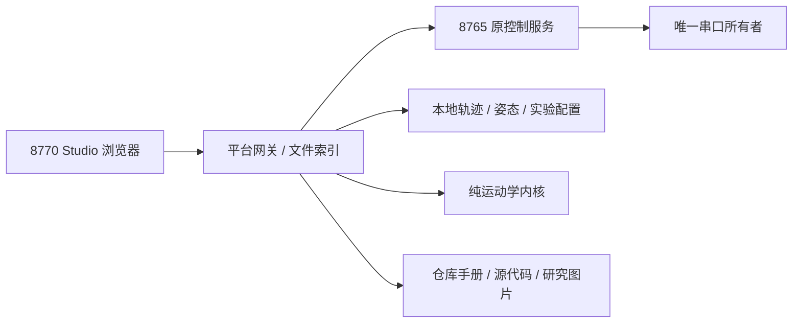

# XLeRobot Studio 一体化工作台

入口：**http://127.0.0.1:8770**。以本机当前仓库为依据，整合控制、设备、数据、仿真、视觉、学习和操作手册。

2026-10-29用户改为车载Windows笔记本中控，迁移和SSH部署见[Windows指南](../../../deployment/windows/README_ZH.md)。工作端通过SSH隧道使用`http://127.0.0.1:18770`，控制板按USB序列号保留逻辑角色、允许实际COM号变化。新机尚未联调。

## 启动与服务关系

在仓库根目录运行：

```powershell
# 原控制服务未启动时才需要；不要重启仍在线的接管。
.\fabrication\assembly\debug_console\start.ps1
# 一体化平台独立启动，不重启8765。
.\fabrication\assembly\debug_console\start-platform.ps1
```

平台使用`.venv-debug`，依赖FastAPI、uvicorn、httpx；图片分析还使用Pillow、numpy和OpenCV。环境缺失时按本目录调试台文档安装，不运行原示例的实机初始化代码。



`stop-platform.ps1`只按PID和命令行停止8770；正在录制时拒绝停止。不会停止8765、切换控制目标、结束或恢复接管。平台默认仅环回地址，手机可访问的局域网部署仍需后续认证与通信适配。

## 工作区

- **总览**：实际服务、会话、电机和资料数量。服务在线与硬件在线分别显示。
- **控制中心**：原版Xbox整机和旧单关节调试；复用既有页面与执行层，保留映射、日志和通道门控。页面首次挂载后切换导航不销毁控制iframe；心跳仍受原服务规则约束，断连只暂停、保留接管。
- **设备与相机**：实际电机范围、目标/位置、模式、扭矩、温度与电压；读取限位快照；带支撑确认的整体/单电机扭矩。接管在线时设备页禁用扭矩与读取限位。相机按需加载，不把历史名称当作当前有画面。
- **数据工作室**：2/5/10Hz状态轨迹，录制停止、异常中断识别、列表、ZIP导出、可拖动时间轴和只读回看。保存计划/编码器姿态；预览姿态可载入沙盒。没有自动实机复位或回放。
- **仿真实验室**：独立双臂运动学沙盒、按住操作、预设伸取/驾驶动画、重置与姿态收藏；原MuJoCo两层/候选方案/评分图可放大。演示播放不改变后台沙盒；收藏保存后台沙盒状态。
- **视觉实验室**：本地图片或相机单帧，分析亮度、暗部/高亮比例和Laplacian方差。图片只驻留内存、不归档。阈值为启发式；不等于目标识别或抓取可用。
- **学习实验室**：ACT/SmolVLA实验配置、PowerShell命令生成/复制、配置保存；显示三个虚拟环境中可索引的软件包版本。不会下载权重、联网训练或执行策略。
- **图文手册**：14篇中文操作路线，配原生SVG流程图、映射图、范围图和仓库图片。包括装配、校准、数据、视觉、PICO、学习、语言技能、导航、手机架构及3D打印。
- **能力全景**：20项能力按领域与集成程度筛选；全局搜索覆盖能力、手册和源文件，源文件可只读查看与复制。

## 四种能力标记

“已接入”代表Web工具已实现，其实际设备仍需连接并满足原控制器门控；“待适配”代表上游有代码、尚未接入本机完整链路；“图文指南”提供配置及操作路线；“社区参考”是外部项目或研究入口。

YOLO检测/分割/跟随、同步图像的LeRobot采集、VR/PICO实机、训练执行、策略闭环、ROS2导航和自动打印均没有被包装成已可运行的按钮。原Xbox/YOLO/VR示例可能主动连接硬件、修改模式或归零，平台不会直接启动这些脚本。

状态轨迹每帧保留`profile`、手柄输入、计划姿态及实际编码器；它不含同步相机图像，**不是原生LeRobot数据集**。实机模式的示意图仍是计划值，不代表测量到的末端坐标。沙盒不包含动力学、碰撞或稳定性求解。

## 本地资料和接口

资料存于`platform-data/`，可用`XLEROBOT_PLATFORM_DATA`指定独立目录。该目录及PID、日志已忽略，不提交Git。没有自动删除或云同步。

- `GET /api/platform/catalog`：能力、手册、源文件白名单、图片索引。
- `GET /api/platform/status`：上游状态、录制状态/存储错误、资料数量、环境索引。
- `POST /api/platform/recordings/start`及`/stop`；`GET /recordings/{id}`及`/export`。
- `POST /api/platform/poses`；`POST /api/platform/sandbox/pose/{id}`仅载入预览姿态。
- `GET /api/platform/sandbox`；`POST /sandbox/step`、`/reset`；`GET /sandbox/demo/{reach|drive}`。
- `POST /api/platform/vision/quality`：原始图片请求体，最多8MB/2000万像素；`GET /camera/{0|1|2}/frame`读取单帧。
- `POST /api/platform/experiments`：只生成配置；`GET /api/platform/library`读取本地资料。

以上缩写路径均相对于`/api/platform`。平台只代理明确列出的原控制API与三路相机；不接受任意目标URL、任意本地文件、脚本执行或命令参数。POST检查本地Origin。源文档先转义再显示，原始HTML不执行。

## 验证

```powershell
.\.venv-debug\Scripts\python.exe -m pytest fabrication/assembly/debug_console/test_platform.py fabrication/assembly/debug_console/test_control_runtime.py fabrication/assembly/debug_console/test_original_teleop.py -q
node fabrication/assembly/debug_console/test_platform_dashboard.cjs
node fabrication/assembly/debug_console/test_dashboard.cjs
node fabrication/assembly/debug_console/test_original_dashboard.cjs
```

测试使用假状态/HTTP传输，不接触真实串口。浏览器验收覆盖状态回看、独立沙盒、配置与源文件；实机动作、摄像头成像、PICO和训练执行另行验收。响应式窄屏样式已经实现，尚不能宣称完成真实手机验收。
